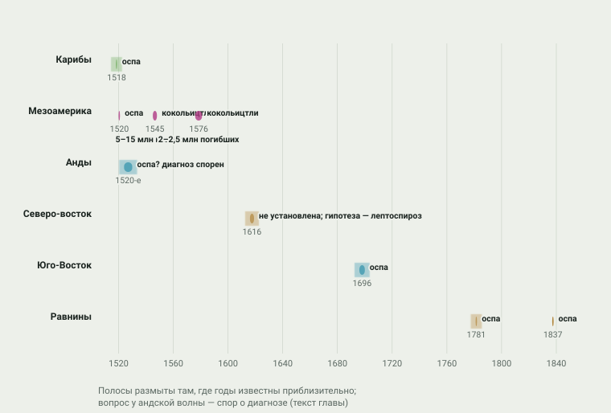
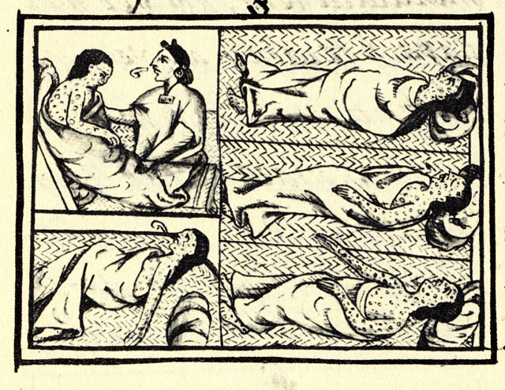
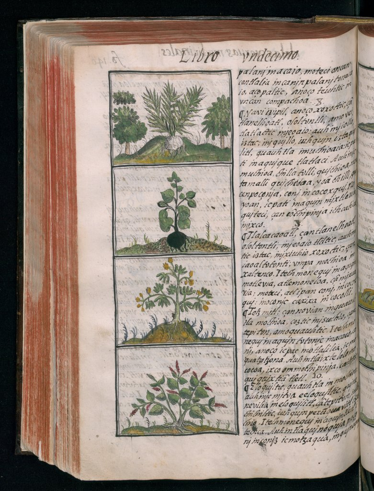
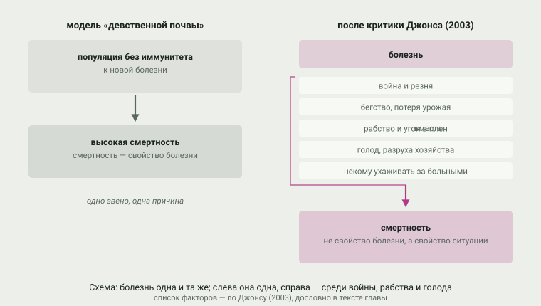
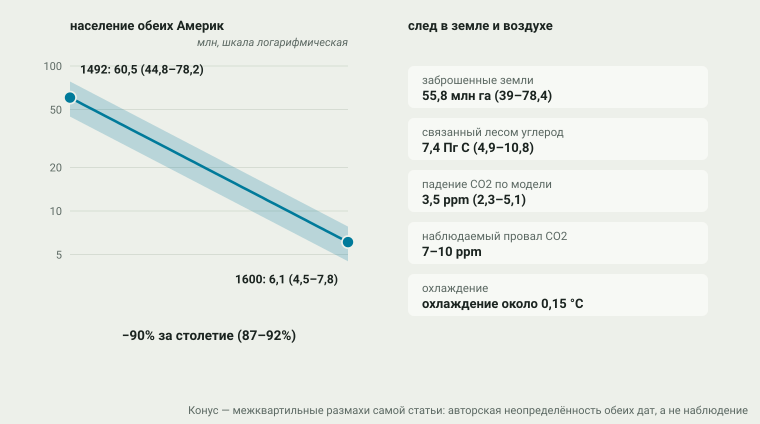

# 5. Эпидемии

> **Статус:** черновик.

[Глава 4](04-perehodnaya-zona.md) показала провинцию Хемес, где люди умирали не до
прихода колонистов, а вместе с ними. Эта глава — о том, что происходило
всюду: о болезнях, пришедших из Европы и Африки после 1492 г., и о
демографической катастрофе, которую они вызвали. Опорный тезис конспекта
№ 3 говорит: эпидемии XVI–XVII вв. — катастрофа, во многом предшествовавшая
завоеванию. Проверить его — значит ответить на три вопроса: сколько людей
жило в Америках до контакта, как шли волны болезней и почему смертность
была такой разной.

Короткий итог проверки. Тезис держится для хронологии — во многих местах
болезни действительно приходили раньше армий и переселенцев, — но не
объясняется одной «девственной почвой», то есть отсутствием иммунитета.
Модель Альфреда Кросби, объяснявшая всё иммунитетом, сегодня считается
недостаточной: как показывает Дэвид Джонс, смертность определяло и то,
что происходило вокруг болезни, — война, бегство, рабство, голод,
разрушение хозяйства. Масштаб же катастрофы приходится обсуждать в
диапазонах: даже на 2026 г. оценки численности 1492 г. расходятся от восьми
до ста миллионов человек, и честный график здесь — полоса разброса, а не
одна линия.

## Сколько людей жило в Америках в 1492 году

Сосчитать население Америк на 1492 г. напрямую нельзя: переписей нет, а
хроники и списки дани покрывают кроху континентов. Поэтому считают
наоборот: от известных поздних чисел — первых переписей и списков
плательщиков — вычитают убыль, оценённую по коэффициентам, либо считают
«вместимость» земель — сколько людей могли прокормить разные ландшафты при
известном хозяйстве. Отсюда два полюса. Генри Добинс брал отношение
дочисленной убыли 20:1 и получал для полушария около 90 миллионов, а в
более поздних работах — до 112; низкие счётчики середины XX в. — Кробер,
Розенблат, Стюард — останавливались на 8–15 миллионах.[^dobyns1966][^denevan1992b]
Убелакер, суммируя оценки по регионам для справочника Смитсоновского
института, получил для Северной Америки севернее Мезоамерики 1 894 350
человек — точность до десятков здесь выглядит насмешкой, но таков был
метод: сложить региональные оценки.[^ubelaker1988]

Уильям Деневан в статье «Миф о нетронутой природе» предложил рабочее
число 53,9 млн (сам он давал разброс ±20%) и показал, куда смотреть:
«многие учёные считают 40–100 миллионов».[^denevan1992b] Самая свежая
сводка — Кох, Брирли, Маслин и Льюис (2019): они собрали 119
опубликованных региональных оценок и пропустили их через модель, которая
учитывает и датировку, и неопределённость каждой. Итог: в 1492 г. в обеих
Америках жило 60,5 млн человек (межквартильный размах 44,8–78,2 млн), а
к 1600 г. — 6,1 млн (4,5–7,8): убыль около 90% за столетие.[^koch2019]

<picture>
  <source media="(prefers-color-scheme: dark)" srcset="img/05-estimates-dark.svg">
  
</picture>

**Рис. 5.1.** Сколько людей жило в Америках в 1492 г.: оценки разных
авторов, по регионам. *Оценки:* полосы и точки — из
[data/epidemics.json](../data/epidemics.json) со ссылками на источники; часть
чисел — в передаче Коха и соавторов (2019), у ранних авторов — в передаче
Деневана (1992); шкала логарифмическая, среднего между оценками нет
намеренно — разброс и есть главное содержание рисунка.

Один пример показывает, как делаются такие оценки и как они ломаются.
Для Эспаньолы большинство сводок дают по всем Карибам 300–500 тысяч
человек, но главный источник — свидетельство Бартоломе де Лас Касаса,
по которому на одном острове жило около 4 млн; от него пошла оценка
Кука и Бораха в 8 млн для Эспаньолы — и именно её раскритиковал
Хениге: сомнительны и отношение «работники — население», и список
плательщиков 1496 г., на котором всё держится.[^koch2019] Первая
перепись острова 1508 г. нашла 60 тысяч человек — уже после эпидемий и
золотых промыслов; к 1570 г. в живых по сводкам оставалось 22
тысячи.[^koch2019] Деневан для всей Эспаньолы принимал 1 млн — и
«несколько сотен» жителей пятьдесят лет спустя.[^denevan1992b]

> [!NOTE]
> **Оценка конспекта.** Читая любые числа этой главы, полезно помнить
> правило самого Деневана: разброс оценок — не потому, что историки
> плохие, а потому, что данные разные и неполные. Поэтому на графике нет
> «средней» линии: полоса — это позиции авторов, а не статистический
> доверительный интервал, и два автора могут использовать одни и те же
> хроники, но по-разному их взвесить. Число Коха и соавторов выделено не
> как «правильное», а как самое свежее и методически явное.

## Волны: болезни шли впереди армий

Хронология эпидемий — то место, где тезис № 3 проверяется прямо. Если
болезни приходили в землю раньше европейцев, значит, они шли по тем же
цепочкам обмена и тем же дорогам, о которых говорила
[глава 3](03-slozhnye-obshchestva.md), — только быстрее людей (рисунок 5.2).

<picture>
  <source media="(prefers-color-scheme: dark)" srcset="img/05-waves-dark.svg">
  
</picture>

**Рис. 5.2.** Волны эпидемий по регионам, XVI–XIX вв. *Данные:* из
[data/epidemics.json](../data/epidemics.json) со ссылками на источники; полосы
размыты там, где годы известны приблизительно; вопросительный знак у андской
волны — спор о диагнозе (текст ниже).

**Карибы, 1518.** Оспа пришла на острова в 1518 г. — «непреднамеренно
христианами или их вассалами», как пишет Роберт Маккаа, — и в 1519-м
вспышка на Кубе совпала с выходом экспедиции Кортеса: больные пошли с
ним на материк.[^mccaa2000] Сам Берналь Диас видел, откуда началось:
Нарваэс «привёз с собой негра, больного оспой», от которого «болезнь
разошлась, как истинный мор, по всей Новой Испании».[^diaz1632]

**Мексика, 1520.** В Теночтитлане оспа вспыхнула ещё при осаде; новый
правитель Куитлауак, по хронике Теососомока в передаче Маккаа, вступил на
престол 16 сентября 1520 г. и умер от оспы «восемьдесят дней
спустя».[^mccaa2000] Оценки смертности первой волны дают разными
способами: пять-восемь миллионов жизней (оценка, которую приводят
Акунья-Сото и соавторы по Куку и Симпсону) или 30–50% населения
Центральной Мексики (сводка Коха и соавторов по трём работам).[^acunasoto2002][^koch2019]

**Анды, 1520-е.** В державу инков болезнь пришла до Писарро и, судя по
хроникам, убила императора Уайна Капака — от этого началась война его
сыновей, описанная в [главе 6](06-udar-po-centru.md). Но какой именно была
болезнь, не установлено: год смерти Уайны Капака в источниках гуляет от
1524 до 1530-го, Вака де Кастро писал об «оспенной заразе», Сьеса де
Леон — об эпидемии 1527–1528 гг., унёсшей «более двухсот тысяч душ»,
Бетансос описывает болезнь, «лишившую его разума».[^mccaa2004] Маккаа, Нимлос и
Хампе Мартинес прямо заключают: документальные доказательства
существования оспы в Перу до 1558 г. «тонки и противоречивы», а до этой
даты главным фактором убыли они считают «десятилетия гражданских войн,
разрушений и угнетения».[^mccaa2004] Смерть Уайны Капака от оспы —
растиражированная, но не доказанная версия.

**Кокольицтли, 1545 и 1576.** Самые тяжёлые эпидемии Мексики называются
[кокольицтли](../glossary.md#кокольицтли) — «зло» на языке науатль. Волна
1545–1548 гг. убила, по оценкам Кука и Симпсона в передаче Акунья-Сото и
соавторов, от 5 до 15 млн человек — до 80% населения; волна 1576–1581 гг. —
ещё 2–2,5 млн, около половины оставшихся.[^acunasoto2002] Симптомы,
записанные врачом Эрнандесом в 1576 г., — лихорадка, чёрный язык,
кровотечения из носа и глаз, смерть за три-четыре дня — не похожи ни на
оспу, ни на корь: Акунья-Сото и соавторы считают кокольицтли
геморрагической лихорадкой, возможно местной, с грызуном-переносчиком, и
показали, что обе большие волны пришлись на «мегазасуху» — самую тяжёлую
за шестьсот лет.[^acunasoto2002] В 2018 г. Вогене и соавторы прочли
геномы из зубов погребённых на кладбище эпидемии 1545 г. в Оахаке и
нашли у десяти человек Salmonella enterica Paratyphi C — возбудителя
брюшного тифа; авторы предлагают считать его «сильным кандидатом», но
окончательного ответа нет: одна находка не доказывает, что именно
сальмонелла убила миллионы.[^vagene2018]

<picture></picture>

**Рис. 5.3.** Оспа 1520 г. в изображении науатль: лист из книги XII
Флорентийского кодекса Бернардино де Саагуна (ок. 1577). Текст на языке
науатль к этому листу перечисляет признаки болезни и говорит, что
умиравших нельзя было хоронить как положено. *Первоисточник:* Florentine
Codex, book XII, fol. 54; World Digital Library; Wikimedia Commons,
общественное достояние; воспроизведение уменьшено.[^sahagun1577]

**Новая Англия, 1616–1619.** За три года до Плимута «большинство
индейцев юго-восточного побережья нынешнего Массачусетса» умерло от
болезни, щадившей европейских рыбаков; современники описывали лихорадку,
кровотечения из носа и желтуху.[^marr2010] Диагноз не установлен до сих
пор: предлагали чуму, оспу, тиф, гепатиты; Марр и Кэти добавили
лептоспироз с синдромом Вейля — заразу, которую завезённые на кораблях
крысы оставляли в воде и на берегу.[^marr2010] Эпидемия шла именно там,
где развивалась торговля пушниной и рыбный промысел, — вокруг планов
будущей колонии, а не впереди неё.

**Юго-Восток, 1696.** «Великая юго-восточная оспа» 1696–1700 гг. прошла
от Виргинии до Мексиканского залива на фоне уже полувековой работорговли:
по сводке Тай Эдвардса (по Келтону), колонисты Южной Каролины поработили
около 50 000 индейцев за 1670–1715 гг., и именно спрос на землю и рабов
подорвал здоровье общин раньше болезни.[^edwards2015]

**Равнины, 1781 и 1837.** Оспа пришла на северные равнины по торговым
путям: в 1781–1782 гг. она опустошила деревни манданов, выжившие ушли
ближе к хидатсам.[^nps-knri] В 1837-м вирус приехал на пароходе
«Сент-Питер»: трое больных арикара сошли на берег у форта Кларк 19 июня;
торговец Франсис Шардон записал в дневнике 14 июля смерть первого мандана
от оспы; к августу, по его счёту, болели две трети манданов.[^ferch1983]
Манданы сократились до 125 человек, хидатсы потеряли около
половины.[^nps-knri] Истории о преднамеренном заражении одеялами ходят
давно, но по доступным текстам не подтверждаются — и не опровергаются:
единственное твёрдое здесь — безразличие властей.[^ferch1983]

<picture></picture>

**Рис. 5.4.** «Правила лечения»: лист книги XI Флорентийского кодекса
(fol. 140v) — лекарственные растения с описаниями на науатле. С этой
собственной фармакопеей тиситль встретил болезнь, которой в ней не было.
*Первоисточник: Florentine Codex*, book XI, fol. 140v; World Digital
Library; Wikimedia Commons, общественное достояние (Public Domain Mark
1.0); воспроизведение уменьшено.[^florentine-f140v]

> [!NOTE]
> **Оценка конспекта.** Волны действительно часто обгоняли европейцев —
> Карибы и Куба, Мексика, Анды до Писарро, Новая Англия до Плимута, — и
> это лучший довод за тезис № 3. Но у обгона есть механизм: цепочки
> обмена, дороги и торговые фактории. Там, где цепочек не было, волны
> глохли: Хемес в [главе 4](04-perehodnaya-zona.md#нью-мексико-миссии-и-упадок-пуэбло)
> не опустел от эпидемий 1520–1530-х гг. — постоянная колония пришла
> туда лишь через поколение. «Предшествовать завоеванию» болезнь умеет
> там, где уже есть контакт; чудом она не распространяется.

## Почему такая смертность: «девственная почва» и её критика

Почему умирало так много? Первый ответ дал Альфред Кросби в 1976 г.:
это были [эпидемии «девственной почвы»](../glossary.md#эпидемия-девственной-почвы) —
популяции, «не имевшие прежнего контакта с этими болезнями и потому
почти беззащитные иммунологически».[^crosby1976] Сам Кросби оговаривался,
что особой «восприимчивости индейцев», кроме среды, наука не видит, — но
формула прижилась: болезни объясняли всё.

Критику собрал Дэвид Джонс (2003). По Джонсу, теория девственной почвы
описывает катастрофу как «уникальный иммуно-исторический момент» и этим
убирает из картины всё остальное: а остальное — список социальных
условий, каждый пункт которого повышал смертность. «Любой фактор,
вызывающий умственный или физический стресс, — перемещение, война,
засуха, уничтожение посевов, истощение почв, сверхработа, рабство,
недоедание, социальный и экономический хаос, — повышает
восприимчивость к болезни».[^jones2003] Смертность определяли и
устройство общества до контакта, и характер колонизации — насколько
частым и жестоким был контакт.[^jones2003]

<picture>
  <source media="(prefers-color-scheme: dark)" srcset="img/05-virgin-dark.svg">
  
</picture>

**Рис. 5.5.** Две картины смертности: болезнь сама по себе и болезнь в
окружении войны, рабства и голода. *Схема:* упрощение аргументов Джонса
(2003) и Келтона (2007); список факторов — по Джонсу, дословно в тексте
главы.

Дальше эту линию развили Келтон и Ресендес. По Келтону (в изложении
Эдвардса), на Юго-Востоке эпидемии шли рука об руку с работорговлей: общины,
разорённые набегами за рабами и согнанные с земель, болели тяжелее, а
болезни, в свою очередь, делали новых пленников.[^edwards2015]
Ресендес прямо переносит акцент: по его оценке, между Колумбом и 1900 г.
порабощено было от 2,5 до 5 млн коренных американцев, и «другое рабство»
— долговое, судебное, «приписное» — убивало не меньше болезней.[^resendez2016]
В Канаде ту же связь — болезни, договоры, политика голода — показал
Дашук для равнин; сама книга конспекту недоступна, и это честная
отметка.[^daschuk2013]

И ещё одна поправка к «девственной почве»: Америки не были стерильны.
Туберкулёз существовал здесь за тысячу лет до контакта — геномы
микобактерий из перуанских скелетов показывают, что его в Южную Америку,
по-видимому, принесли тюлени.[^bos2014] «Беззащитность» была не
абсолютной, а конкретной: к конкретным новым болезням.

## Обратный обмен и спор о сифилисе

[Колумбов обмен](../glossary.md#колумбов-обмен) работал в обе стороны — но
болезней из Америк в Европу «уехало» намного меньше. Объяснение, которое
приводят Кох и соавторы со ссылкой на Макнила и других: большинство
эпидемических болезней Старого Света произошли от одомашненных животных,
а в Америках одомашненных животных было мало.[^koch2019]

Главный кандидат в «американские» болезни — сифилис, и его история —
хороший пример того, как меняется наука. Классическая «колумбийская
гипотеза» говорит: болезнь привезли в Европу матросы Колумба, и
эпидемия 1490-х в Италии и Франции была первой. Палеопатологи Харпер и
соавторы (2011) проверили все 54 сообщения о «доколумбовом» сифилисе
Старого Света и не нашли «ни одного случая с достоверным диагнозом и
надёжной доколумбовой датой» — то есть против классической гипотезы
прямых данных нет.[^harper2011] Но и она сама потеснилась: Маяндер и
соавторы (2024) прочитали геномы трепонем из почти двухтысячелетних
останков в Бразилии — и это оказались родственники беджеля, не
венерического сифилиса; дивергенция подвидов трепонем уходит вглубь
доколумбовых времён.[^majander2024] А в колониальной Мексике
Шойнеманн и соавторы (2018) нашли геномы сразу двух подвидов, включая
признаки врождённой фрамбезии.[^schuenemann2018]

> [!IMPORTANT]
> **Гипотеза.** Единой «привозной» истории у сифилиса, скорее всего,
> нет: древняя ДНК показывает, что разные трепонемные болезни —
> венерический сифилис, беджель, фрамбезия — разошлись ещё до 1492 г., и
> контакт мог разбудить и разнести по миру уже существовавшее
> разнообразие. Это прочтение данных 2018–2024 гг.; окончательного
> согласия в литературе нет, и каждая новая находка геномов может
> картину изменить.

## Климатический след

Если в 1492 г. в Америках жило десятки миллионов человек, а к 1600-му —
единицы, то целый континент перестал обрабатывать землю. Кох и соавторы
посчитали последствия: 61,9 млн га сельскохозяйственных земель 1492 г.
(43,3–87,1); заброшено после катастрофы 55,8 млн га (39,0–78,4); выросший
на них лес связал 7,4 Пг углерода (4,9–10,8), что равносильно падению
содержания CO₂ в воздухе на 3,5 ppm (2,3–5,1); с учётом обратных связей
это 47–67% реального провала CO₂ — 7–10 ppm в конце 1500-х — начале
1600-х гг., охладившего планету примерно на 0,15 °C.[^koch2019] Так
демографическая катастрофа Америк оставила след во льду Гренландии и
Антарктиды (рисунок 5.6).

<picture>
  <source media="(prefers-color-scheme: dark)" srcset="img/05-collapse-dark.svg">
  
</picture>

**Рис. 5.6.** Великая убыль и её след в атмосфере. *Данные:* Koch et al.
2019, аннотация и табл. 1 (полный текст, открытый доступ); полосы —
межквартильные размахи самой статьи, то есть авторская неопределённость
синтеза, а не ошибка измерения.

Но и здесь есть спор — и о нём надо сказать честно. Кинг и соавторы
(2024) сверили картину с новым ледяным керном Скайтрейн: резкий провал
CO₂ около 1610 г. в «широко используемой записи», по их выводу, может
быть артефактом нескольких аномально низких значений; данные лучше
согласуются с плавным снижением.[^king2024] Спор идёт не о том, была ли
убыль, — а о форме сигнала: скачок или наклон.

## Вывод

Тезис № 3 конспекта после проверки выглядит так.

| Утверждение (тезис № 3 и его версии) | Что показывают источники | Итог |
|---|---|---|
| Эпидемии — демографическая катастрофа | 60,5 → 6,1 млн за столетие, убыль ~90% (Кох и соавторы); 53,9 → 5,6 млн к 1650 г., 89% (Деневан) | держится; масштаб — диапазоном |
| Болезни шли впереди завоевания | Карибы 1518, Куба 1519, Мексика 1520, Анды 1520-е, Новая Англия 1616–1619 | держится там, где уже были цепочки контакта; Хемес — контрпример |
| Причина — отсутствие иммунитета («девственная почва») | Джонс: смертность определяли и война, бегство, рабство, голод; Келтон, Ресендес: работорговля как усилитель | модель недостаточна; работает только вместе с социальными условиями |
| Оспа убила Уайну Капака | Маккаа и соавторы: доказательства до 1558 г. «тонки и противоречивы»; диагнозы хроник расходятся | не установлено |
| Возбудитель кокольицтли — сальмонелла | Вогене и соавторы: Paratyphi C — «сильный кандидат», 10 геномов из жертв 1545 г.; Акунья-Сото: геморрагическая лихорадка | не установлено; две живые гипотезы |
| Сифилис привезён из Америк в 1493 г. | Харпер: надёжных доколумбовых случаев Старого Света нет; Маяндер 2024: трепонемы в Бразилии ~2000 лет назад, родство с беджелем | простая версия ослаблена; полной ясности нет |

Что может измениться. Оценки численности пересматриваются с каждой
археологической сводкой; геномы возбудителей — самая быстрая область:
сальмонелла-1545 (2018) и трепонемы из Бразилии (2024) появились за
последнее десятилетие, и следующая находка может склонить спор.
Ледяные керны читают по-разному (Кох 2019 против Кинга 2024), и
«климатический след» пока предмет методического спора. Для Канады и
бразильской Амазонии конспект опирается на недоступные полные тексты —
при первой возможности их стоит сверить.

Дальше, в [главе 6](06-udar-po-centru.md), болезнь станет фоном войны:
Теночтитлан падёт в год оспы, а в Анды испанцы придут в разгар
эпидемической гражданской войны. В [главе 7](07-loshad-i-ruzhyo.md) волны
достигнут равнин и сожгут кормовую базу конных культур задолго до
солдат. А в [главе 12](12-vozvrashchenie.md) — реверс: те же народы,
потеряв девять десятых населения, к XX–XXI вв. численно восстановятся.

## Источники

[^denevan1992b]: Denevan 1992, разд. «Indian Numbers» (полный текст, скан на сервере Вашингтонского университета).
[^dobyns1966]: Dobyns 1966, аннотация (полный текст недоступен; «около 90 000 000» — из аннотации издательства).
[^ubelaker1988]: Ubelaker 1988, аннотация (только аннотация).
[^koch2019]: Koch, Brierley, Maslin & Lewis 2019, аннотация; табл. 1; разд. Population estimates, Caribbean, Mexico, Central America, Inca Territory, Amazonia; разд. о CO2 (полный текст, открытый доступ, UCL Discovery).
[^mccaa2000]: McCaa, «Revisioning Smallpox in Mexico City-Tenochtitlán», рабочая версия (полный текст, авторская страница Университета Миннесоты).
[^mccaa2004]: McCaa, Nimlos & Hampe Martínez 2004, Introduction и Conclusion (полный текст, авторская страница; цитаты хроник — в передаче авторов).
[^diaz1632]: Díaz del Castillo 1568/1632 (пер. Локхарта, 1844), гл. о знамениях (полный текст, Project Gutenberg № 32474–32475).
[^acunasoto2002]: Acuna-Soto et al. 2002, стр. 360–361 (полный текст, CDC; числа смертей — по оценкам Кука и Симпсона в передаче авторов).
[^vagene2018]: Vågene et al. 2018, аннотация и вывод (полный текст открыт у издателя; конспекту доступна аннотация и пересказ в открытых обзорах).
[^marr2010]: Marr & Cathey 2010, введение и раздел гипотез (полный текст, PMC2957993).
[^edwards2015]: Edwards 2015, абзацы о Юго-Востоке и работорговле (полный текст; числа — по Kelton 2007, cc. 49–50 и др., в передаче автора обзора).
[^resendez2016]: Reséndez 2016 (книга недоступна; оценка 2,5–5 млн порабощённых — по интервью автора, History News Network, 8 января 2017 г.).
[^daschuk2013]: Daschuk 2013 (только описание; тезис болезни и политики голода — по открытому названию и рецензиям, не по тексту).
[^crosby1976]: Crosby 1976, определение «девственной почвы» — в передаче Jones 2003, с. 703–704 (фрагмент; полный текст статьи конспекту недоступен).
[^jones2003]: Jones 2003, с. 703–704, 708, 731–732 (полный текст, открытая учебная копия MITx/edX).
[^bos2014]: Bos et al. 2014, аннотация (полный текст открыт в PMC; конспекту доступна аннотация).
[^harper2011]: Harper et al. 2011, аннотация (только аннотация).
[^majander2024]: Majander et al. 2024, аннотация и фрагменты полного текста (PMC10917687).
[^schuenemann2018]: Schuenemann et al. 2018, аннотация (полный текст открыт в PMC).
[^king2024]: King et al. 2024, аннотация и выводы (полный текст, PMC10915154).
[^nps-knri]: National Park Service, Knife River Indian Villages, страницы Mandan и Hidatsa (полный текст).
[^ferch1983]: Ferch 1983–84, начальные страницы (полный текст перепечатки 2020 г.).
[^sahagun1577]: Sahagún, Florentine Codex, ок. 1577, book XII (изображения; World Digital Library и Digital Florentine Codex; Wikimedia Commons, общественное достояние).
[^florentine-f140v]: Sahagún, Florentine Codex, book XI, fol. 140v — описания лекарственных растений (скан World Digital Library, item 10622; Wikimedia Commons, Public Domain Mark 1.0).
