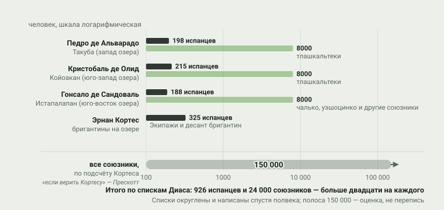
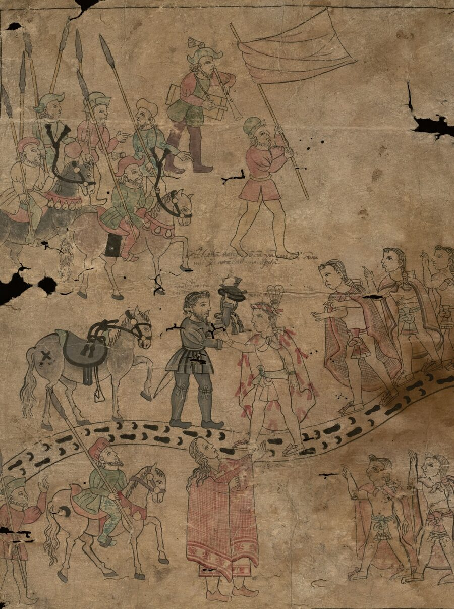
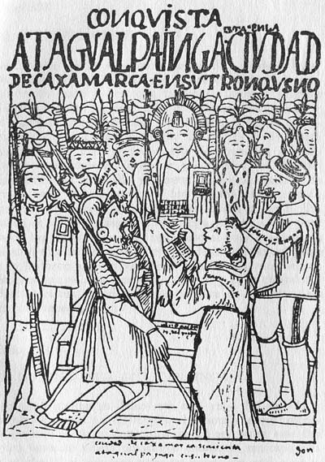
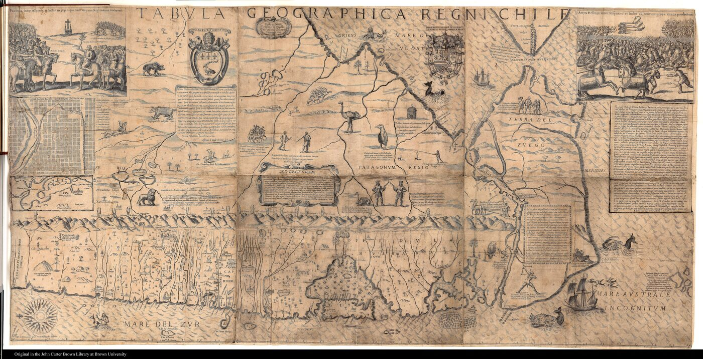

# 6. Удар по центру

> **Статус:** черновик.

[Глава 4](04-perehodnaya-zona.md) закончилась тем, у кого центра не было: испанская
империя сорок лет воевала с «чичимеками» и не победила. Эта глава — о другом
случае: что произошло там, где центр был. Держава мешика (ацтеков) с её
данью и столицей на озере, держава инков с её складами, дорогами и
переселениями — [глава 3](03-slozhnye-obshchestva.md) показала, как они были
устроены. Здесь — как они пали: обе — за считаные годы, обе — руками
десятков тысяч индейских союзников, и обе — на фоне болезней, о которых
подробно расскажет [глава 5](05-epidemii.md).

Опорный тезис конспекта № 6 говорит: на юге завоевание шло через удар по
централизованным государствам, а мобильные децентрализованные народы держались
дольше. Короткий итог проверки: тезис держится, но не так, как его обычно
рассказывают. «Горстка европейцев» не разбивала империи — Теночтитлан брали
десятки тысяч тлашкальтеков, которым война с мешика была их собственной
войной, а у Куско испанцы несколько месяцев держались с тысячей индейских вспомогательных воинов. Быстрота падения объясняется не превосходством оружия —
историки завоевания его скептически взвешивают, — а тем, что пирамиду власти
можно было захватить целиком и переключить её механизмы на новые цели: ту же
дань, тот же принудительный труд. И ровно поэтому контрпримеры так важны:
майя без единого царя сопротивлялись сто семьдесят лет, мапуче не покорились
вовсе, а централизованное государство пурепеча (тарасков) испанцы вообще не
разбивали — оно сдалось само, и это тоже путь к потере самостоятельности.

## Кто взял Теночтитлан

В апреле 1519 г. Берналь Диас дель Кастильо, солдат экспедиции Эрнана
Кортеса, стоял на острове Косумель на смотре войск. Он запишет об
этом спустя полвека — и даст число, к которому историки возвращаются до сих
пору: «не считая пилотов и матросов, нас было 508 человек» — плюс 109
матросов, шестнадцать лошадей и одиннадцать судов.[^diaz1632] С этим отрядом
Кортес пошёл на Теночтитлан.

По дороге ему пришлось воевать — не с империей, а с республикой Тлашкалой.
Тлашкала не входила в Тройственный союз и не была покорена им, но была
заперта: по свидетельствам, которые сводит Прескотт, мешика десятилетиями
перекрыли ей подвоз — «больше полувека у них не было ни хлопка, ни какао, ни
соли».[^prescott1843] Война шла как затяжная блокада, перемежаемая
[«цветочными войнами»](../glossary.md#цветочные-войны) — по Россу Хассигу, это
была не «охота за пленными», как думали раньше, а институционализированная
война на измор против сильных противников.[^hassig1988] Когда в 1519 г. в
тлашкальские земли вошли испанцы, правитель Шикотенкатль Младший собрал,
по заглавию главы у Диаса, «20 000 отборных воинов» и несколько недель
атаковал их.[^diaz1632] Потом старейшины Тлашкалы решили иначе: не добивать
чужаков, а сделать их союзниками в собственной войне — и отправились в
испанский лагерь просить мира.[^diaz1632] Диас писал: «старые касики»
пришли в лагерь и заключили союз, который они потом поддерживали
десятилетиями.

Так война Кортеса с Теночтитланом стала продолжением войны Тлашкалы с
Теночтитланом. После изгнания испанцев из столицы в «печальную ночь» 1520 г.
Диас считал погибшими 550 своих.[^diaz1632] Зимой 1520/21 г. оспа, пришедшая
с подкреплением Нарваэса, — «от него болезнь разошлась, как истинный мор, по всей
Новой Испании», — выкосила и мешика (об этом — [глава 5](05-epidemii.md)).[^diaz1632] А весной 1521 г. к городу
сошла армия, состав которой Диас перечисляет по соединениям — и это самый
показательный список во всей главе (рисунок 6.1).

<picture>
  <source media="(prefers-color-scheme: dark)" srcset="img/06-siege-dark.svg">
  
</picture>

**Рис. 6.1.** Кто осаждал Теночтитлан в 1521 г. По спискам самого Диаса:
у Альварадо под Такубой — 150 пехотинцев, 30 всадников, 18 стрелков и 8000
тлашкальтеков; у Олида под Койоаканом — 165 пехотинцев, 30 всадников, 20
стрелков и снова 8000 тлашкальтеков; у Сандоваля у Истапалапана — 150
пехотинцев, 24 всадника, 14 стрелков и 8000 воинов чалько и уэшоцинко;
Кортес вёл по озеру бригантины с 325 людьми.[^diaz1632] *Данные:* Диас, гл. CLI
(перевод Локхарта); общая численность союзников — по подсчёту самого Кортеса
у Прескотта.[^prescott1843] Полоса 150 000 — оценка одного автора, а не
перепись; шкала логарифмическая.

Списки Диаса складываются в 926 испанцев и 24 000 союзников — и это только
первые силы, вставшие вокруг озера.[^diaz1632] Подкрепления стекались всё лето, и общую
численность союзников сам Кортес оценивал в 150 000 воинов; правитель
Тескоко Иштлильшочитль, по его же счёту, привёл 50 000 — Прескотт
оговорился: «если верить Кортесу».[^prescott1843] Рестолл приводит для
финального штурма цифру 200 000 «туземных союзников» — с теми же оговорками
об источнике.[^restall2003] Осада, по счёту самого Диаса, длилась девяносто
три дня непрерывного шума: «наши уши осаждали и днём и ночью все возможные
звуки».[^diaz1632] 13 августа 1521 г., в день святого Ипполита, последний
правитель мешика Куаутемок был взят в плен на лодке посреди
озера.[^diaz1632]

<picture></picture>

**Рис. 6.2.** Встреча Кортеса и тлашкальского правителя — лист *льенсо де
Тлашкалы*, рисуночной летописи, созданной в Тлашкале через поколение после
завоевания. Тлашкальские правители потом веками подчёркивали свои заслуги
перед испанской короной — этот лист часть той же аргументации. *Первоисточник:*
Lienzo de Tlaxcala, ок. 1550; Wikimedia Commons, общественное достояние.[^lienzo1550]

> [!NOTE]
> **Оценка конспекта.** Числа Диаса и Кортеса округлены и написаны задним
> числом, но даже по нижней границе — 24 000 союзников при 926 испанцах —
> на каждого испанца приходилось больше двадцати союзников. Вывод, который
> делает и Рестолл, разбирая «миф о белом конкистадоре»: Теночтитлан взяли
> не горстки европейцев, а коалиция местных сил, у каждой из которых были
> свои счёты с державой мешика.[^restall2003] Союз был выгоден обеим
> сторонам — и это вопрос [главы 8](08-epoha-balansa.md), где такие
> коалиции станут главным механизмом целой эпохи.

## Кахамарка: арест, а не битва

В Андах повторился тот же рисунок — с той разницей, что там испанцам не
нужно было даже воевать.

К приходу испанцев держава инков уже была надломлена. Уайна Капак, как
сводит Прескотт свидетельства хроник, умер в конце 1525 г. — меньше чем за
семь лет до появления Писарро, — и перед смертью совершил, по выражению
Прескотта, «самый немудрый акт своей жизни»: разделил державу между двумя
сыновьями, оставив старинное царство Кито Атауальпе, а остальное —
Уаскару.[^prescott1847] Почти пять лет братья правили порознь без
столкновений; потом — послы, претензии и война, претензии и война, которую Прескотт
пересказывает с оговоркой, что даже близкие по времени хроники расходятся в
причинах и ходе событий.[^prescott1847] Армию Атауальпы вели два старых
полководца его отца, Кискис и Чаликучима; война шла на севере державы, и
к 1532 г. Уаскар был разбит и взят в плен.[^prescott1847] Отчего умер Уайна
Капак, доступные конспекту хроники не говорят; версия об оспе, пришедшей в
Анды раньше испанцев, — распространённое, но не подтверждённое
предположение (путь болезней впереди европейцев — тема
[главы 5](05-epidemii.md)).

В эту щель между двумя половинами державы и вошёл Писарро. Его третья
экспедиция, по Прескотту, была меньше экспедиции Кортеса: «не больше ста
восьмидесяти человек при двадцати семи лошадях» — и Писарро знал, что
армия Атауальпы стоит в горах неподалёку.[^prescott1847] 16 ноября 1532 г.
в Кахамарке победитель гражданской войны сам приехал к испанцам — без
оружия, как подчёркивает Прескотт, «в полной уверенности» и в сопровождении
свиты: когда на площадь вошло «пять или шесть тысяч» его людей, испанцы,
прячущиеся по дворам, ударили одновременно.[^prescott1847] Это не битва, а
засада и арест. Вечером Писарро, по Прескотту, подсчитал потери и нашёл,
что «ни один человек не был ранен».[^prescott1847]

<picture></picture>

**Рис. 6.3.** Встреча Атауальпы и Писарро глазами андского автора: лист из
«Новой хроники и доброго правления» Гуамана Помы де Айяла (ок. 1615).
Гуаман Пома — сын андской знати — писал свою хронику для испанского короля
как обвинение колониальному порядку. *Первоисточник:* Guaman Poma de Ayala,
*El primer nueva corónica*, ок. 1615; Королевская библиотека Дании;
Wikimedia Commons, общественное достояние.[^guamanpoma1615]

Дальше произошло то, ради чего засада и задумывалась. Пленный правитель предложил выкуп — обещал, по словам Санчо,
«наполнить дом золотом» и вдвое больше серебром. Педро Санчо, секретарь Писарро,
вёл счёт: поступило золота «на два с половиной миллиона песо», после
переплавки — «миллион триста двадцать с лишним тысяч», из которых королевская
пятая часть составила «двести семьдесят с лишним тысяч»; серебра — «пятьдесят
тысяч марок», десять тысяч из них — короне.[^sancho1534] Выкуп был выплачен
целиком. Выплатив выкуп, Атауальпа был приговорён к сожжению и после крещения удушен гарротой — «вместо огня ему
обвили верёвку вокруг шеи», пишет Санчо.[^sancho1534] Формального повода для
казни не было: приговор объясняли «пользой» — как передаёт Прескотт, страхом,
что живой пленник соберёт армию.[^prescott1847] 15 ноября 1533 г. испанцы с
союзными отрядами вошли в Куско.[^sancho1534]

Захват вершины сработал и здесь — до предела. Но нижние этажи пирамиды
инков оказались прочнее, чем у мешика. Манко Инка, посаженный испанцами
марионеточным правителем, в 1536 г. поднял восстание: по Прескотту, осада
Куско началась в начале февраля 1536 г., и весь объединённый испанский
гарнизон — «не больше двухсот человек, конных и пеших, не считая тысячи
индейских вспомогательных воинов», — полгода держался в городе против «легионов», чьи
костры ночью покрывали окрестные холмы, «как звёзды в безоблачное летнее
небо».[^prescott1847] Осаду Манко снял; сам ушёл в труднодоступные горы,
где его преемники — сыновья Куси Титу Юпанки и Тупак Амару — «состояли в
горах Вилькапампы», как пишет Маркэм во вводной статье к изданию
Сармьенто, сохраняя независимость.[^sarmiento1907] Последнего из них, Тупак
Амару, вице-король Толедо в 1572 г. захватил и казнил в Куско.[^sarmiento1907] Маркэм
называет это «судебным убийством» и передаёт ответ Филиппа II вице-королю,
приехавшему отчитываться в Мадрид: «Ступай домой: я посылал тебя служить
королям — а ты поехал убивать королей».[^sarmiento1907]

## Переключение пирамиды: дань и труд на новых хозяев

Почему захват вершины вообще мог работать? Потому что обе державы были
[гегемонией данников](../glossary.md#гегемония-данников-империя) и системой
повинностей, а не сплошной колонизацией. У мешика покорённые города-государства
платили дань столицам по спискам — захватить стоило столицы и склады, а
механизм сбора оставался прежним. У инков подданные отрабатывали
[трудовую повинность](../glossary.md#мита), и она тоже переключалась.

Новым владельцем вершины стал не столько сам король, сколько частные
лица. Завоевания финансировались как долевые предприятия: командир
набирал солдат, которые платили за долю добычи, — и добычей становилась не
только военная контрибуция вроде выкупа Атауальпы, но и право на труд
завоёванного населения, [энкомьенда](../glossary.md#энкомьенда). В Андах ту
же роль взяла на себя перестроенная [мита](../glossary.md#мита): с 1573 г.
та же инкская доля — одна седьмая взрослого мужского населения — стала
ежегодно направляться на рудники Потоси и Уанчавелы: по сводкам, опирающимся
на монографии Коула и Делл, около тринадцати тысяч человек в год (рисунок
6.4).[^cole1985][^dell2010][^bakewell1984]

<picture>
  <source media="(prefers-color-scheme: dark)" srcset="img/06-switch-dark.svg">
  
</picture>

**Рис. 6.4.** Переключение пирамиды: что менялось при захвате вершины, а что
нет. *Схема:* упрощение по устройству обеих держав из
[главы 3](03-slozhnye-obshchestva.md); числа по мите — в тексте выше, сводки по
недоступным конспекту монографиям — см. сноски. Устройство держав сложнее
схемы: у инков, по Вернке, прямое управление соседствовало с косвенным.

> [!NOTE]
> **Оценка.** Числа потосийской миты (одна седьмая, около тринадцати тысяч
> в год) конспект приводит по открытым сводкам; сами книги Коула, Делл и
> Бейкуэлла конспекту недоступны, и это честная граница главы. Важно и
> другое: механизм выжил, потому что был полезен. Энкомьенда в Мексике и
> рудничная мита в Перу — не «новый порядок», наброшенный поверх руин, а
> старые повинности с новым адресатом. Именно поэтому захват вершины был
> выгоднее, чем казалось: он окупался сразу.

## Контрпримеры: где нечего было захватывать

Тезис о «центре» проверяется контрпримерами — и они показывают, что
отсутствие центра было необходимо для долгого сопротивления, но не
достаточно для спасения.

**Майя.** На Юкатане не было державы, какую можно было захватить одним
ударом: десятки соперничающих владений, каждое со своей династией и армией.
Экспедиция Монтехо высадилась в 1527 г. примерно с четырьмя сотнями людей —
и растеряла силы в войнах, в которых каждый город приходилось брать или
уговаривать отдельно; закрепиться удалось лишь к 1540-м, а восстание
восточных провинций в конце 1546 г. стало последним большим выступлением,
после которого север полуострова вошёл в колонию.[^jones1998][^restall2003]
Горная страна петенских ица держалась дольше всех: их островную столицу
Нохпетен испанцы штурмом взяли 13 марта 1697 г. — через сто семьдесят лет
после высадки Монтехо.[^jones1998] Рестолл разбирает это под названием
«мифа о завершённости»: покорёнными объявляли земли, где власть держалась
на бумаге.[^restall2003]

**Пурепеча.** Тарасское государство в Мичоакане было устроено
централизованно — и не было разбито ни в одном сражении. По данным,
собранным Уорреном, экспедиция Кристобаля де Олида пришла в Цинцунцан в
1522 г., и касонси (правитель) Тангашуан II признал верховную власть,
сохранив управление: сложилось двойное правление, при котором дань шла и
Кортесу, и касонси.[^warren1985][^pollard1993] В 1530 г. конкистадор Нуно
де Гусман, по тем же данным, обвинил касонси в тайных связях с врагами
испанцев и казнил.[^warren1985][^pollard1993] Для тезиса это важнее, чем
кажется: централизация делала государство уязвимым не только к разгрому,
но и к «переключению» — сдаться мог один человек, и сдалась вся система.

**Мапуче.** На юге Анд испанцев остановили вовсе. После основания Сантьяго
в 1541 г. война с мапуче — «война Арауко» — шла столетиями.[^ovalle1646] В декабре
1553 г. при Тукапеле погиб конкистадор Педро де Вальдивия (в источниках
встречаются даты 25 декабря 1553 г. и 1 января 1554 г. — расхождение само
по себе говорит о качестве хроник); против него воевал Лаутаро — по
преданию, бывший конюх в его собственной конюшне.[^ovalle1646][^bengoa1985]
К середине XVII в. стороны пришли не к покорению, а к договору: первый
большой «парламент» в Кильине (1641 г.) закрепил фактическую границу по
реке Био-Био и порядок переговоров, который держался до эпохи республик —
об этом механизме подробнее в [главе 8](08-epoha-balansa.md).[^bengoa1985]

<picture></picture>

**Рис. 6.5.** Королевство Чили на карте иезуита Алонсо де Овалье (1646):
узкая полоса между океаном и горами, по которой шла война. Овалье описывал
и «парламенты» с мапуче — карту и хронику создали в одно время с миром
Кильина. *Первоисточник:* Tabula geographica Regni Chile, 1646; Wikimedia
Commons, общественное достояние; снимок уменьшен.[^ovalle1646]

**«Чичимеки».** Северная граница Мезоамерики, где центра не было ни у кого,
разобрана в [главе 4](04-perehodnaya-zona.md): сорок лет войны без победы —
и подчинение не силой, а «миром покупкой». Здесь она — ещё одна строка
сравнения.

## Сколько держались

Если свести сроки на одну шкалу (рисунок 6.6), рисунок получится яснее
любого определения: там, где была вершина пирамиды, она падала за годы;
там, где пирамиды не было, — за десятилетия и века.

<picture>
  <source media="(prefers-color-scheme: dark)" srcset="img/06-falls-dark.svg">
  
</picture>

**Рис. 6.6.** Сколько держались: от первого столкновения до утраты
самостоятельности. *Схема по данным главы:* у каждого народа своё начало и
конец — определение выписано в источниках главы; полоса ица ведётся от
высадки Монтехо на Юкатане в 1527 г., хотя сами ица не воевали с испанцами
все эти 170 лет. Даты — из текста главы со сносками.

Но у этой ясности есть предел, и его надо назвать честно. Во-первых, сроки
определяла не только структура общества: Теночтитлан пал в год оспы, Тауантинсуйу —
после гражданской войны, а испанцы шли туда, где было серебро и золото;
север без сокровищ ждал своей очереди. Во-вторых, сама «структура» — не
только про центр: майя были земледельцами с городами, чичимеки — подвижными
охотниками, и держались одинаково долго — но по-разному кончили. В-третьих,
«упасть» и «исчезнуть» — разные вещи: тлашкальтеки, сломавшие Тройственный
союз, не исчезли; исчезали потом другие и по другим причинам — о них
[глава 11](11-assimilyaciya.md).

Наконец, технологии. Рестолл в главе о «мифе о превосходстве» перечисляет,
что реально давали испанцам сталь, лошади и аркебузы — и приходит к выводу,
что в решающих сражениях их было мало и все они были в дефиците: перевес
делали союзники, болезни и расколы среди индейцев.[^restall2003] Хассиг о
военной системе мешика — та же оценка: преимущество «нескольких сотен
испанских солдат не было подавляющим».[^hassig1988] Оспа 1520 г. в
Центральной Мексике убила, по оценке, которую приводят Акунья-Сото и
соавторы, пять-восемь миллионов человек — больше, чем все армии завоевания
вместе взятые могли бы.[^acunasoto2002] Как болезни вообще смогли пройти
континентом впереди европейцев — тема следующей главы.

## Вывод

Тезис № 6 в его осторожной форме источники поддерживают: у
централизованных держав захватчики нашли вершину, за которую можно было
ухватиться, и этим объясняется быстрота их падения. Но глава показала три
уточнения, без которых тезис превращается в миф.

Первое: сила «удара по центру» — не в огне и стали, а в коалициях. Обе
столицы брали армии, в которых индейцы составляли девяносто с лишним
процентов, и каждая община шла за своим счётом — Тлашкала за полвека
блокады, уанка и каньяри — за разгром, учинённый армией Атауальпы в
гражданскую войну. Второе: захват вершины был выгоден, потому что
переключал готовые механизмы — дань и трудовую повинность — на новых
адресатов; в этом смысле энкомьенда и потосийская мита продолжили державы,
а не отменили их. Третье: отсутствие центра спасало сроки, но не народ.
Майя сопротивлялись дольше всех — и были покорены по частям; чичимеки
получили «мир покупкой» — и, как показано в главе 4, исчезли; пурепеча
сдались целиком — и потеряли правителя. Не покорились только те, у кого
не было ни пирамиды, ни воли чужой пирамиды служить, — и мапуче
останутся главным примером до конца конспекта.

| Утверждение (тезис № 6 и его версии) | Что показывают источники | Итог |
|---|---|---|
| Удар по центру объясняет быстроту падения | Теночтитлан — 2 года, Куско — 2 года, обе операции оплачены чужими войсками | держится |
| «Горстка европейцев» разбила империи | 926 испанцев и 24 000 союзников у Диаса; 150 000 по Кортесу; 200 000 у Рестолла; «не было подавляющим» (Хассиг) | миф: перевес делали союзники |
| Технологии решили исход | Рестолл: сталь, лошади, аркебузы — в дефиците и мало решали; оспа 1520 г. — 5–8 млн погибших (Акунья-Сото) | технологии — фон, а не причина; болезни и коалиции весомее |
| Децентрализованные держатся дольше | ица — 170 лет, чичимеки — 42, мапуче — не покорены; майя покорены по частям к 1546/1697 | держится для сроков |
| Децентрализация спасает народ | чичимеки после «мира покупкой» исчезли (гл. 4); майя покорены по частям; пурепеча сдались целиком и без боя | «дольше» ≠ «спастись» |

Что может измениться. Числа участников пишут победители и очевидцы задним
числом: список дивизий Диаса — свидетельство участника, но написанное через
полвека; числа армий в хрониках расходятся в разы, и историки их
пересматривают. Само понятие «завершённого» завоевания — предмет спора
(Рестолл). О потосийской мите конспект цитирует по сводкам — при доступе к
монографиям Коула и Делл числа стоит сверить. И глава почти не касается
африканцев в завоевании — о роли африканских рабов и вольноотпущенников в
испанской Америке конспекту нужен отдельный источник.

Дальше — [глава 7](07-loshad-i-ruzhyo.md): о том, что случилось, когда
мобильность, которая здесь спасала сроки, соединилась с лошадью и ружьём.
Но прежде — [глава 5](05-epidemii.md): о болезни, которая убила больше
людей, чем все конкистадоры Америк.

## Источники

[^diaz1632]: Díaz del Castillo 1568/1632 (пер. Локхарта, 1844): смотра войск на Косумеле (гл. о смотре); война с Тлашкалой (заглавия гл. LXX и LXXIV); оспа с экспедицией Нарваэса (гл. о знамениях); дивизии осады (гл. CLI); «девяносто три дня»; пленение Куаутемока «в день св. Ипполита, 13 августа 1521 г.» (полный текст, Project Gutenberg № 32474–32475).
[^prescott1843]: Prescott 1843, т. 2 (блокада Тлашкалы: «больше полувека ни хлопка, ни какао, ни соли»), т. 4 (войска союзников при осаде: 150 000 по Кортесу, 50 000 по Иштлильшочитлю — «если верить Кортесу») (полный текст, Project Gutenberg № 59820, 59832).
[^prescott1847]: Prescott 1847: третья экспедиция «не больше 180 человек при 27 лошадях»; смерть Уайна Капака в конце 1525 г. и раздел державы; «почти пять лет» мира между братьями; полководцы Кискис и Чаликучима; сцена в Кахамарке («пять или шесть тысяч», «ни один человек не был ранен»); осада Куско с начала февраля 1536 г. («не больше двухсот… не считая тысячи индейцев», костры «как звёзды…») (полный текст, Project Gutenberg № 1209).
[^sancho1534]: Sancho 1534 (пер. 1917): счёт выкупа (2,5 млн песо; 1 320 000 после переплавки; пятая часть — 270 с лишним тысяч; 50 000 марок серебра); удушение гарротой после крещения; вход в Куско 15 ноября 1533 г. (полный текст, Project Gutenberg № 26602).
[^sarmiento1907]: Sarmiento de Gamboa 1572, изд. Маркэма 1907: вводная статья — сыновья Манко «в горах Вилькапампы»; казнь Тупак Амару как «судебное убийство»; ответ Филиппа II Толедо (полный текст, Project Gutenberg № 20218).
[^hassig1988]: Hassig 1988, заключение и с. 225 (через поиск по книге; полный текст недоступен) — фрагмент.
[^restall2003]: Restall 2003: гл. о «мифе о белом конкистадоре» (200 000 союзников), «мифе о завершённости», «мифе о превосходстве» (поиск по книге и открытые обзоры) — фрагмент и описание.
[^jones1998]: Jones 1998: Нохпетен пал 13 марта 1697 г.; завоевание Юкатана (только описание).
[^warren1985]: Warren 1985: Олид в Цинцунцане, двойное правление, казнь Тангашуана II Нуно де Гусманом (только описание).
[^pollard1993]: Pollard 1993: казнь касонси в передаче источников (фрагмент, поиск по книге).
[^ovalle1646]: Ovalle 1646: хроника войны и «парламентов»; карта Regni Chile (только описание; воспроизведение карты — Wikimedia Commons).
[^bengoa1985]: Bengoa 1985: война Арауко, парламент в Кильине (только описание).
[^lienzo1550]: Lienzo de Tlaxcala, ок. 1550 (изображение; Wikimedia Commons, общественное достояние).
[^guamanpoma1615]: Guaman Poma de Ayala, ок. 1615 (изображение; Королевская библиотека Дании; Wikimedia Commons, общественное достояние).
[^cole1985]: Cole 1985 (только описание).
[^dell2010]: Dell 2010 (только описание).
[^bakewell1984]: Bakewell 1984 (только описание).
[^acunasoto2002]: Acuna-Soto et al. 2002, стр. 360 (полный текст, CDC; числа смертей — по оценкам Кука и Симпсона в передаче авторов).
