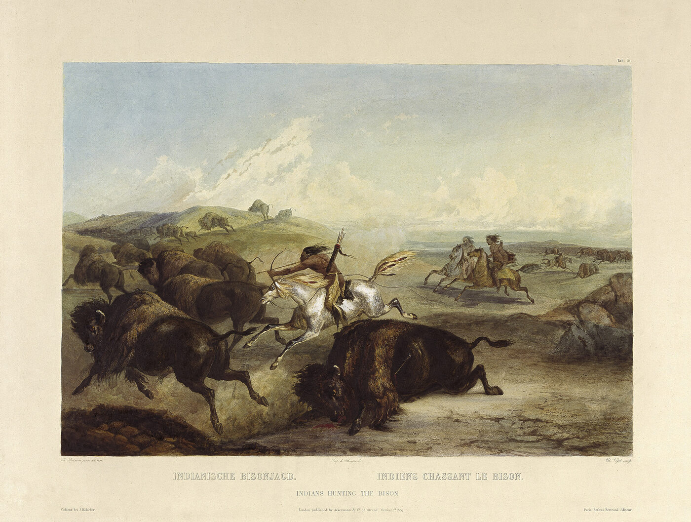
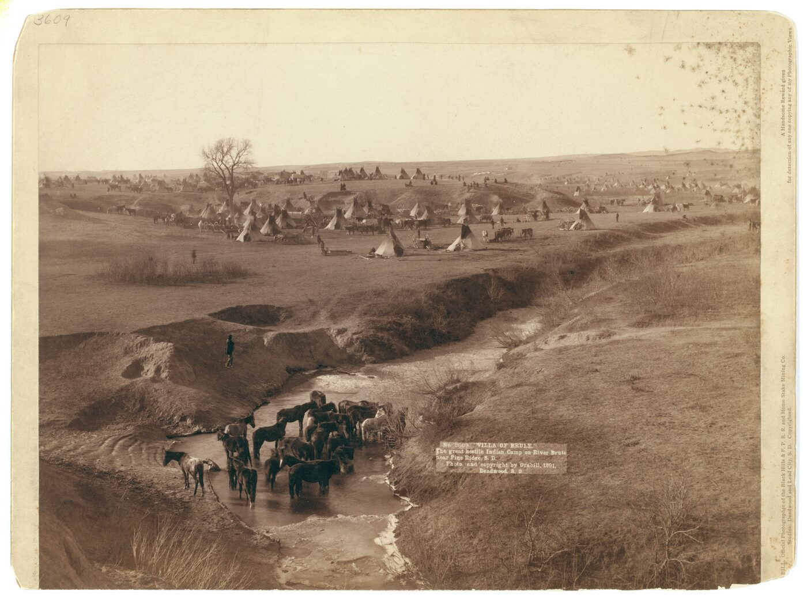
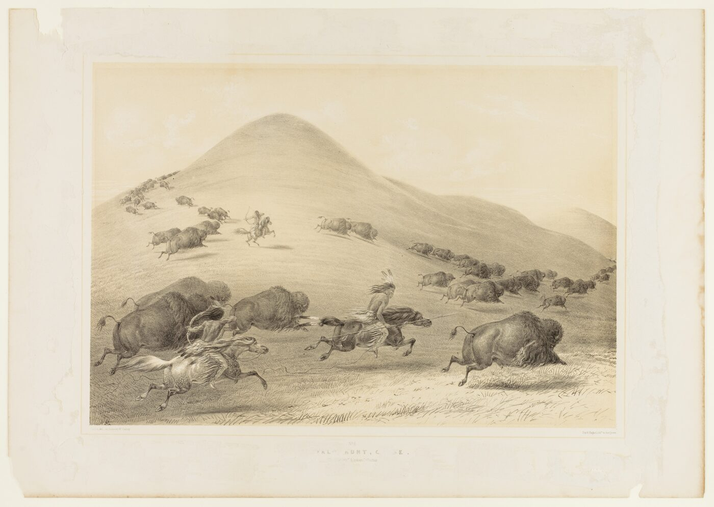

# 7. Лошадь и ружьё

> **Статус:** черновик.

[Глава 4](04-perehodnaya-zona.md) закончилась восстанием пуэбло, после которого
лошади быстрее пошли по равнинам, — но подчеркнула, что ещё до 1680 г. восточные
нде покупали лошадей в Нью-Мексико. Эта глава — о том, что из этого выросло:
как за полтора века пешая окраина материка стала миром конных охотников, где
делались судьбы империй. Опорный тезис конспекта № 4 говорит: «классический
индеец» равнин — конный охотник на бизонов — явление послеконтактное.

Короткий итог проверки. Тезис держится, но с одной поправкой, которую сами
источники внесли позже плана: лошади пришли на равнины не после восстания
пуэбло, а задолго до него. Прямые датировки костей и древняя ДНК (2023)
показывают, что коренные общины запада усвоили лошадь между 1516 и 1599 гг.,
а на северных равнинах она была уже в первой половине XVII в.[^taylor2023]
Восстание 1680 г. — не начало, а ускорение: оно бросило на рынок тысячи
испанских лошадей. А дальше заработали два встречных потока, описанные
Фрэнком Секоем: лошадь шла с испанского юго-запада, ружьё — с
французского и британского северо-востока, и встретились они у земледельческих
деревень Верхней Миссури. Равнины стали перекрёстком — и породили народы,
которые следующие полтораста лет будут играть роль самостоятельных держав.

## Раньше, чем думали

До недавнего времени историю можно было рассказывать одной строкой: испанцы
в Новом Мексико — восстание пуэбло 1680 г. — лошади в руках индейцев —
распространение на север. Рассказ опирался на документы, потому что других
свидетельств не было. В 2023 г. появились другие: Уильям Тейлор, Пабло
Либрадо и соавторы (в коллективе — и исследователи из народа оглала-лакота)
собрали кости ранних лошадей из музеев, датировали их радиоуглеродом,
прочли их геномы и изучили изотопы.[^taylor2023] Итог по срокам: начало
усвоения лошадей коренными общинами запада — между 1516 и 1599 гг.
(двухсигмальный интервал, медиана около 1544 г.); на севере — в Айдахо —
лошадь известна между 1597 и 1657 гг.; три лошади из аборигенных контекстов
датированы «однозначно раньше восстания пуэбло».[^taylor2023]

Сами лошади оказались не одичавшим скотом, а животными, о которых заботились:
жеребёнок из Blacks Fork (Вайоминг) по изотопам вырос и умер там же, где
найден, а у лошади из долины реки Kaw (Канзас) зубы несут «характерные
повреждения, связанные с использованием металлического трензеля».[^taylor2023]
Геномы ранних лошадей ближе всего к испанским линиям; британская примесь
приходит позже.[^taylor2023] Авторы прямо пишут, что данные согласуются с
устными историями команчей и шошонов о раннем знакомстве с лошадью, —
устная традиция здесь подтвердилась археологией.[^taylor2023]

<picture>
  <source media="(prefers-color-scheme: dark)" srcset="img/07-spread-dark.svg">
  
</picture>

**Рис. 7.1.** Когда народы равнин получили лошадей. *Данные:* из
[data/horses.json](../data/horses.json) со ссылками; почти все даты восходят к
одному своду — Юэрсу (1955), который сам опирался на записи современников и
работы историков; форма метки показывает надёжность (документ /
традиция-оценка). Точка Тейлора и соавторов (усвоение с 1516–1599 гг.) стоит
левее шкалы — она не про один народ, а про весь запад.

## Два фронтира

Лошадь распространялась не как дикое пламя, а по цепочкам обмена — тем самым,
о которых шла речь в [главе 3](03-slozhnye-obshchestva.md#как-вещь-рассказывает-о-своём-пути).
Первыми посредниками стали юты, получавшие лошадей от испанцев (по традиции,
записанной в 1930-е, — «около 1640 г.»), и команчи, отколовшаяся от шошонов
ветвь с территории нынешнего Вайоминга: в испанских записях они появляются в
1705–1706 гг., уже конными и в союзе с ютами.[^ewers1955][^tsha-comanche]

С северо-востока шёл другой товар. Французская торговля через долину
Миссисипи и британские фактории Гудзонова залива давали ружья — и первым их
получили посредники: ассинибойны и кри, стоявшие между факториями и
равнинами. Фрэнк Секой в книге 1953 г. описал это как движение двух
«военных фронтиров» — конного с юго-запада и ружейного с северо-востока; сам
его текст конспекту недоступен, но формулу сохранил Юэрс, излагая ту же
модель: «именно у этих деревень северо-восточный фронтир лошади встретил
юго-западный фронтир ружья» — у земледельческих деревень Верхней Миссури,
манданов, хидатс и арикара.[^secoy1953][^ewers1955] Эти деревни и так были
узлом обмена — земледелие обменивалось на охотничью добычу ещё до прихода
европейцев: уже экспедиция Коронадо в 1541 г. видела, как «керечо» меняют
шкуры на маис у жителей речных деревень.[^ewers1955] Теперь через них пошли
две самые ходовые вещи континента (рисунок 7.2).

<picture>
  <source media="(prefers-color-scheme: dark)" srcset="img/07-frontiers-dark.svg">
  
</picture>

**Рис. 7.2.** Два фронтира и место их встречи. *Схема:* модель Секоя (1953;
текст недоступен) в изложении Юэрса (1955, с. 62–63); стрелки — направления
распространения, а не дороги; точки народов — места подписей, не границы
земель.

Кто выигрывал от встречи? Тот, кто получал обе вещи. Ассинибойны уже в
1738 г. приносили ружья к деревням Миссури; черноногие (сиксика), сначала
отстававшие, к 1772 г. были конны поголовно — и, вооружившись через тех же
посредников, отбросили шошонов на юг и запад: «не имея огнестрела, шошоны и
салишские народы были плохо подготовлены противостоять агрессивным и
многочисленным черноногим», — сводит Юэрс.[^ewers1955] Кроу (апсароки),
отделившиеся от хидатс к западу, стали посредниками конной торговли на
Йеллоустоне.[^ewers1955]

## Смена образа жизни

Лошадь меняла не только войну — она меняла хозяйство, и несколько больших
народов сменили образ жизни целиком.

**Шайенны** (самоназвание цууцтавахисы; близкие им суутаи присоединились
позже) в XVII в. жили собирательством дикого риса у озера Мил-Лакс в
Миннесоте. К 1760-м гг. часть бэндов уже была конной; к концу века они
держались у Блэк-Хиллс, «умножили табуны и оставили земледелие ради кочевой
жизни полной охоты на бизона» — так формулирует Джеймс Мур в энциклопедии
Великих равнин; Джордж Берд Гриннелл, записывавший шайеннские предания в
начале XX в., прослеживает тот же путь по их собственной памяти.[^egp][^grinnell1923]

**Лакота** — западная ветвь народа сиу — вышли из лесов Миннесоты под
давлением оджибве, вооружённых французскими ружьями. Равнинным народом они
стали, по Гиббону, «не раньше 1750–1775 гг., перейдя Миссури».[^egp] Лошадей
тетоны получили около 1760 г. — оценка Хайда в передаче Юэрса.[^ewers1955] А в
1777 г. Питер Понд видел у янктонов «великое множество лошадей».[^ewers1955]

**Кроу** (апсароки, «дети большой клювой птицы») пришли к Йеллоустону с
востока, вероятно, ещё до 1600 г.; получив лошадей к 1750-му, они сменили
«оседлое земледелие на охоту на бизона» — так в энциклопедии равнин, и в
этом же источнике — важная честность дат: отделение от хидатс датируется
«вероятно, до 1600 г.», то есть расплывчато и по ранним документам.[^egp]

Выгода была настоящей: конный охотник добывал больше бизона, дальние
переходы открывали торговлю, а торговля — ружья и металл. Но была и цена:
народ, вставший на коня, попадал в зависимость от одного ресурса. Эндрю
Айзенберг, историк-эколог, показал, что «конные индейские номады и
промышленные заготовители» вместе с засухами почти истребили бизона, —
специализация на охоте сделала конные народы уязвимыми к любому сбою в
численности стад.[^isenberg2000] Обмен «огород на мясо», который страховал
и тех и других, исчезал вместе с оседлыми деревнями.

<picture></picture>

**Рис. 7.3.** Конная охота на бизона глазами очевидца: акватинта Карла
Бодмера из атласа к путешествию Максимилиана цу Вида (1833–1834, издано
1839–1841). Бодмер ехал по Миссури как раз тогда, когда конные культуры
северных равнин были в расцвете. *Первоисточник:* Tableau 31; Wikimedia
Commons, общественное достояние; воспроизведение уменьшено.[^bodmer1839]

## Лошадь как богатство — и как предел

Лошадь была не только транспортом, но и богатством, которое считали по
головам. Вот черноногие (пеганы) по данным Юэрса: богатым считался владелец
40–50 лошадей — таких мужчин было меньше 5%; зато до четверти семей владели
меньше полудюжины; богатейшие держали сотни — у вождя Бычья Обувь около
500, у человека по имени Скупой — 200–300.[^ewers1955] Бедные брали лошадей
у богатых в долг и отрабатывали долги охотой — табун работал как ссудный
капитал.[^ewers1955]

<picture></picture>

**Рис. 7.5.** Лагерь у Брюл-Крика близ Пайн-Ридж (Южная Дакота), 1891:
типи, лошади, повозки — конный мир равнин в год, когда военная эпоха уже
кончилась (см. [главу 10](10-sinhronnyj-final.md)). *Фото:* Джон К. Х. Грабилл,
1891; Wikimedia Commons, общественное достояние; снимок
уменьшен.[^grabill1891]

<picture></picture>

**Рис. 7.4.** «Охота на бизона: погоня», литография Джорджа Кэтлина (1844).
Кэтлин писал равнины в 1830-е гг., когда образ конного охотника уже сложился,
— и сам сделал этот образ знаменитым в Европе и США. *Первоисточник:*
North American Indian Portfolio, № 6; Смитсоновский музей американского
искусства; Wikimedia Commons, CC0; воспроизведение уменьшено.[^catlin1844]

Рынок менял и труд, и войну. Выделка шкур — женская работа — стала
промыслом на дальний рынок: индейская роба (шкура зимнего бизона с шерстью)
шла на восток вагонами. Хорнадей потом сведёт счёт: одна железная дорога
Atchison, Topeka & Santa Fe вывезла с южных равнин 165 721 шкуру за
1872 г., 251 443 за 1873-й и 42 289 за 1874-й; по пересчёту полковника
Доджа одна шкура 1872 г. означала трёх убитых бизонов (шкуры на типи и
одежду в счёт товара не шли) — итого за три года белые охотники убили, по
Хорнадею, 3 158 730 бизонов.[^hornaday1889] Война шла за угодья: команчи,
придя на южные равнины, вытеснили апачей — «смертельных врагов»; в 1758 г.
около двух тысяч команчей и союзников разгромили миссию Сан-Саба, а в
1759-м испанская карательная экспедиция у Ред-Ривер была
разбита.[^tsha-comanche]

Экологический предел конной экономики — главный её секрет. Лошади
конкурировали с бизонами за траву и воду: по Хямяляйнену (в его статье для
энциклопедии Великих равнин), «к началу 1840-х речные долины были
перевыпасаны, и огромные стада бизонов вступили в ранний упадок».[^egp]
Конное богатство, таким образом, подтачивало собственную основу — тема,
которую Айзенберг и Флорес разовьют для всего равнинного
экоса.[^isenberg2000][^flores1991]

> [!NOTE]
> **Оценка.** Хямяляйнен называет державу команчей XVIII–XIX вв. «империей»,
> которая «превзошла европейских соперников военной мощью, экономическим
> весом и культурным влиянием» (формулировка издательства); критики
> возражают: Джеральд Бетти — что «империя» тут преувеличение, запутывающее
> само понятие, Дэниел Гело — что это «натяжка», хотя и самый сильный довод
> в пользу внутренней связности и силы команчей.[^hamalainen2008][^betty2008][^gelo2009]
> Для конспекта важно не слово, а содержание: полтора века команчи были
> силой, с которой договаривались империи, — об этом [глава 8](08-epoha-balansa.md).

## Вывод

Тезис № 4 подтвердился и уточнился. Подтвердился тем, что весь конный мир
равнин — явление послеконтактное: до XVII в. на равнинах не было ни одного
конного народного хозяйства, а к началу XIX в. конными стали все народы
равнин (рисунок 7.1). Даты
на рисунке 7.1 складываются в волну, идущую с юго-запада на северо-восток
за полтора века. Уточнился тезис датой начала: археология 2023 г. убрала
точку отсчёта «восстание пуэбло, 1680» — усвоение лошади началось на полтора столетия раньше, и 1680 г. остаётся не началом, а ускорением. Сами конные общества
сложились из двух потоков — лошади и ружья, — и жить умели только пока оба
потока работали: это сделает их сильными в следующей главе и уязвимыми в
[главе 10](10-sinhronnyj-final.md).

| Утверждение (тезис № 4 и его версии) | Что показывают источники | Итог |
|---|---|---|
| Конный охотник — послеконтактное явление | все даты рис. 7.1 после 1640 г.; усвоение лошади с 1516–1599 гг. (Тейлор и соавторы) | держится |
| Лошади пришли после восстания пуэбло 1680 г. | три лошади «однозначно раньше 1680»; Айдахо 1597–1657 | уточнено: раньше и постепеннее; 1680 г. — ускорение |
| Конные культуры самостоятельны и сильны | команчи и черноногие как державы; «империя» Хямяляйнена и её критики | оценка, не факт |
| Конная экономика устойчива | перевыпас долин к 1840-м; зависимость от одного ресурса (Айзенберг) | нет: предел встроен в саму модель |

Что может измениться. Датировки Тейлора и соавторов — самые свежие (2023) и
первые в своём роде: каждая новая серия дат может сдвинуть карту раннего
распространения. Хронология по народам на рис. 7.1 почти целиком опирается
на один свод Юэрса (1955) — при первом доступе к первоисточникам его даты
стоит сверять. Оценки поголовья бизонов — предмет [главы 10](10-sinhronnyj-final.md),
там же их споры.

Дальше — [глава 8](08-epoha-balansa.md): полтора века, когда команчи, лакота,
хауденосауни (ирокезы) и мапуче диктовали свои условия империям, потому что
империи были не одна, а несколько. И [глава 5](05-epidemii.md) уже показала,
какой ценой равнины прошли XVIII век: волны оспы 1781 и 1837 гг. били именно
по деревням-посредникам, связавшим два фронтира.

## Источники

[^taylor2023]: Taylor, Librado et al. 2023, Results и Discussion (полный текст, открыт на сайте Science).
[^ewers1955]: Ewers 1955, гл. «The Northward Spread of Horses» (с. 53–68), гл. о богатстве (с. 75–77), с. 62–63 (фронтиры), с. 72–73 (войны) (полный текст, archive.org).
[^grinnell1923]: Grinnell 1923, гл. 1 и раздел о суутаи (полный текст, archive.org).
[^egp]: Encyclopedia of the Great Plains, открытые статьи: «Horse» (Hämäläinen), «Cheyennes» (Moore), «Crows» (Frey), «Sioux» (Gibbon), «Arapahos» (Fowler) (полный текст).
[^tsha-comanche]: Lipscomb, «Comanche Indians», Handbook of Texas (полный текст).
[^secoy1953]: Secoy 1953 (только описание: текст недоступен, изложение модели — по Юэрсу).
[^hamalainen2008]: Hämäläinen 2008 (только описание; формула — по аннотации издательства Yale UP).
[^betty2008]: Betty 2008, рецензия (аннотация).
[^gelo2009]: Gelo 2009, рецензия (аннотация).
[^isenberg2000]: Isenberg 2000 (аннотация; формулировка о «конных номадах и промышленных заготовителях» — из аннотации издательства).
[^flores1991]: Flores 1991 (аннотация).
[^hornaday1889]: Hornaday 1889, гл. «Statistics of the slaughter» и разд. об охоте верхом (полный текст, Project Gutenberg № 17748).
[^catlin1844]: Catlin 1844, литография № 6 (изображение; SAAM, Wikimedia Commons, CC0).
[^bodmer1839]: Bodmer 1839, Tableau 31 (изображение; Wikimedia Commons, общественное достояние).
[^grabill1891]: Grabill 1891, «Villa of Brule» (изображение; Wikimedia Commons, общественное достояние).
