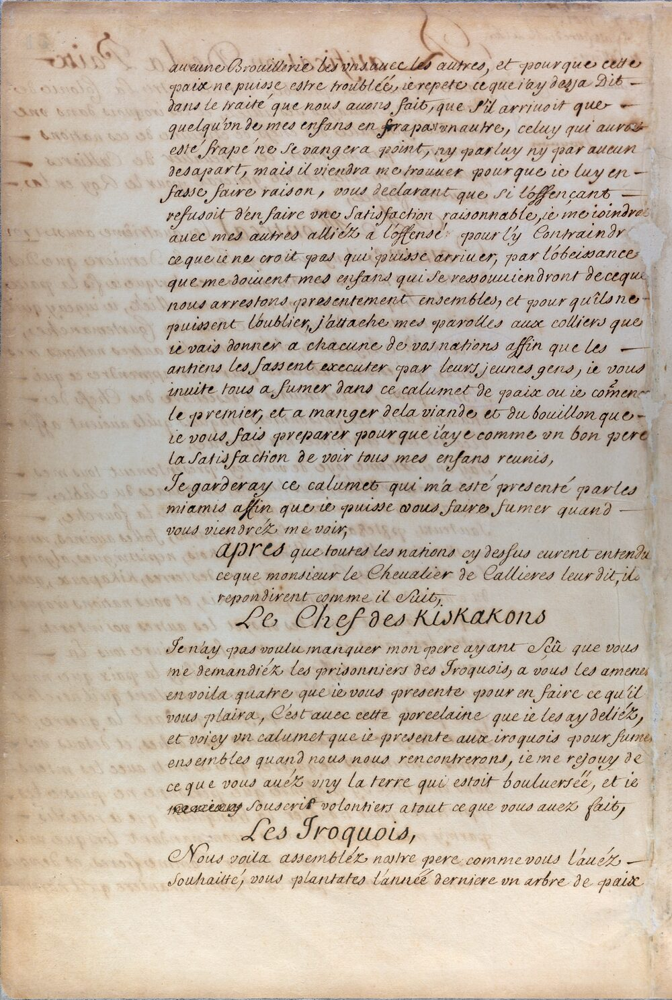
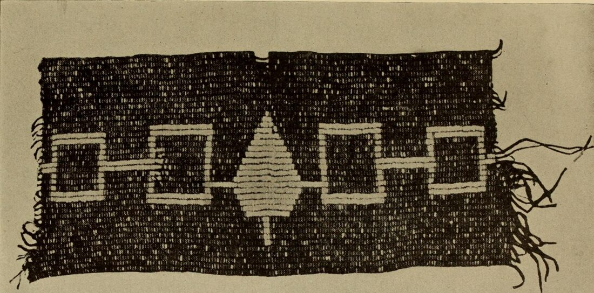
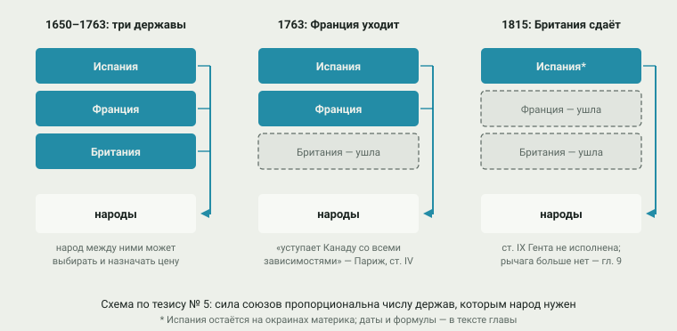
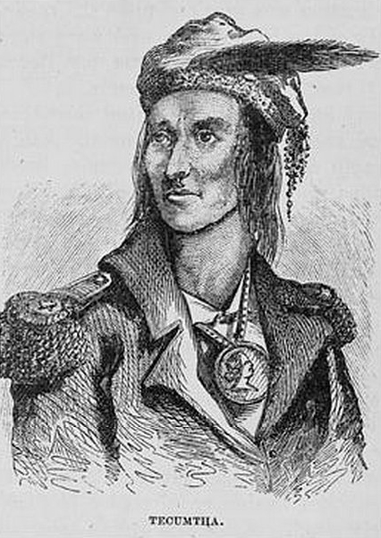

# 8. Эпоха баланса (1650–1815)

> **Статус:** черновик.

[Глава 7](07-loshad-i-ruzhyo.md) оставила равнины в руках новых конных держав —
команчей, черноногих, лакота. Эта глава — о восточной половине континента и о
полутора столетиях, когда коренные народы там были не объектом колонизации, а
её участниками. Опорный тезис конспекта № 5 говорит: их сила держалась на
противоречиях европейских держав, и потеря этого рычага — 1763 год, когда
Франция ушла с материка, и 1815-й, когда Британия оставила союзников, —
открыла эпоху вытеснения ([глава 9](09-pereselenie.md)).

Короткий итог проверки. Тезис держится целиком — с двумя оговорками. Первая:
«баланс» не значит мир; изнутри это выглядело как война всех со всеми, и
столетия «благосклонности» держав оплачены «бобровыми войнами» и работорговлей
([глава 5](05-epidemii.md)). Вторая: рычаг работал не только на востоке. У
команчей он держался до 1840-х, у мапуче — «парламентами» до эпохи республик:
юг жил по той же механике, только с другими датами.

## Срединная земля

Как это выглядело изнутри, лучше всего описал Ричард Уайт на примере страны
Великих озёр. Срединная земля ([middle
ground](../glossary.md#middle-ground-срединная-земля)) — «место между»: между
культурами, народами, между империями и нестатейным миром деревень.[^white1991]
Французы не могли навязать индейцам свою волю — «французы не были хозяевами
индейцев; они были только их союзниками», — и потому обе стороны учились
убеждать друг друга, прибегая к чужим обычаям, которые каждая понимала
по-своему: Уайт называет это «творческими недопониманиями».[^white1991]
Срединная земля держалась, пока ни одна империя не стала в регионе сильнее
других, — и рассыпалась, когда это перестало быть правдой.[^white1991]

## Лига хауденосауни: от «бобровых войн» к равновесию

Сильнее всех научился жить между империями союз пяти (потом шести) народов —
хауденосауни, у европейцев ирокезы. Началось с жестокого: в 1640-е–1650-е гг.
лига, втянувшись в меховую торговлю, рассеяла и частью истребила соседей —
вендов (гуронов), нейтралов, петунов; их разбитые общины расходились по
континенту, и следы этого рассеяния будут видны ещё века.[^tce-iroquoiswars]

Дальше — дипломатия. В 1701 г. в Монреале был заключён Великий мир: Франция
со своими союзниками и Лига прекратили вековую войну — 39 народов прислали
1300 делегатов, и Лига обязалась оставаться нейтральной в войнах Англии и
Франции.[^jaenen2006] Подписи на ратификации — родовые знаки-пиктограммы
вождей (рисунок 8.1); по такому поводу заказывали вампумовые пояса — шнуры с
раковинными зёрнами, на которых фиксировали договоры (рисунок
8.2).[^jaenen2006]

<picture></picture>

**Рис. 8.1.** Ратификация Великого монреальского мира, 4 августа 1701 г.:
под французскими подписями — знаки вождей. *Первоисточник:* Ratification de
la paix…, Bibliothèque et Archives nationales du Québec; Wikimedia Commons,
общественное достояние; снимок уменьшен.[^ratification1701]

<picture></picture>

**Рис. 8.2.** Поясной вампум (публикация 1909 г.): узор из зёрен — запись
договора. Пояса заказывали к большим соглашениям, в том числе к монреальскому
миру 1701 г.; для хауденосауни такой пояс — сама память о союзе, а не его
иллюстрация. *Фото:* публикация 1909 г., Internet Archive Book Images;
Wikimedia Commons, «нет известных ограничений авторского права»; публикация
1909 г. — общественное достояние (США); снимок уменьшен.[^belt1909]

Полвека лига качалась между Францией и Британией, поддерживая «цепь завета»
— систему союзов с английскими колониями (учение о ней — классика Дженнингса
и Рихтера, сами книги конспекту недоступны).[^jennings1984][^richter1992]
Летом 1753 г. онондага провозгласила нейтралитет лиги в назревавшей войне;
Уайт приводит слова современника Рраксолла: ирокезы смотрели на конфликт на
Огайо как на ссору «двух воров, дерущихся из-за имущества ирокезов».[^white1991]

## 1763 год: рычаг ломается

Семилетняя война решила иначе. На континенте осталась одна северная держава:
по Парижскому миру Франция «уступает и гарантирует его величеству
королевства Великобритании в полное право Канаду со всеми её зависимостями»
и мыс Бретон; себе она оставила только острова Сен-Пьер и Микелон «для
убежища французских рыбаков» — с запрещением укреплять их и гарнизоном не
больше пятидесяти человек.[^paris1763] Индейских народов текст договора не
упоминает вовсе — они перешли из одних рук в другие без спроса.[^paris1763]

Британскую империю «наследство» встретило восстанием. Война 1763–1766 гг.
(её называют войной Понтиака) началась с попытки взять форт Детройт и
лишила Британию восьми фортов; мир Понтиак заключил в 1766-м, не уступив
земель.[^calloway2006] Лондон ответил документом, который станет основой
всей дальнейшей земельной политики: Королевская прокламация 7 октября
1763 г. объявила земли за истоками рек, впадающих в Атлантику, «зарезервированными
для названных индейцев… как их охотничьи угодья», запретила частные покупки
у индейцев под страхом наказания и велела покупать земли только короне «на
каком-нибудь публичном собрании или совете названных индейцев».[^proclamation1763]
Колонисты увидели в линии прокламации посягательство; Колин Кэллоуэй
называет 1763 год — год «царапины пера», поменявшей карту, — поворотом,
запустившим «каскад последствий», включая революцию.[^calloway2006]

<picture>
  <source media="(prefers-color-scheme: dark)" srcset="img/08-lever-dark.svg">
  
</picture>

**Рис. 8.3.** Рычаг противоречий и его поломка. *Схема:* иллюстрация тезиса
№ 5; даты — Парижский мир 1763 г. (Франция остаётся только на островах) и
Гентский мир 1814 г. (Британия не добивается индейской буферной территории);
формулировки — в тексте главы со сносками.

## Революция: гражданская война хауденосауни

Американская революция расколола лигу — впервые хауденосауни воевали друг
против друга: при Ориске в августе 1777 г. онейда и тускарора стояли с
американцами, четыре нации — с Британией.[^calloway2006] После войны
союзники Британии ушли на её сторону границы: прокламация Халдиманда 1784 г.
отвела мохокам и шести нациям долину Гранд-Ривер; перепись 1785 г. нашла
там 1843 человека.[^calloway2006] (Даже размер гранта в источниках
расходится — от полумиллиона до двух миллионов акров; конспект приводит
число переписи как более надёжное.)[^calloway2006]

## Северо-запад: Текумсе и последний шанс

На «Старом Северо-Западе» (нынешние Огайо, Индиана, Иллинойс) после 1783 г.
сложилась конфедерация, заставившая США платить за землю кровью.[^white1991] 4 ноября
1791 г. армия генерала Сент-Клэра была уничтожена: по Уайту, потери составили
около двух третей из более чем 1400 человек, убитыми — 600; со стороны
конфедерации погибли 21 воин.[^white1991] После поражения у поваленных
деревьев (1794) конфедерация подписала Гринвиллский мир: двенадцать народов
«уступают навсегда все претензии на земли» к востоку и югу от оговорённой
линии, США — ежегодная рента товарами на 9500 долларов.[^greenville1795]

Следующую попытку собрал Текумсе — шауннский вождь, который вместе с братом
Тенскватавой («Пророком») строил пан-индейский союз, не признававший продаж
земли отдельными деревнями. Сделку в форте Уэйн 1809 г. (более трёх миллионов
акров) он отверг;[^calloway2006] в ноябре 1811 г. отряд Гаррисона атаковал Протфетаун —
Типпекану; в войне 1812 г. Текумсе стал главным союзником Британии и погиб в
битве на Темзе 5 октября 1813 г.[^calloway2006] Портреты его писали уже
после смерти (рисунок 8.4) — современника-очевидца с натуры не рисовали.

<picture></picture>

**Рис. 8.4.** Текумсе в гравюре Бенсона Лоссинга (1868). Прижизненных
портретов нет; этот сделан по описаниям и памяти участников войны 1812 г. —
потребность в образе героя-противника сама по себе примета времени.
*Первоисточник:* Lossing 1868; Wikimedia Commons, общественное
достояние.[^lossing1868]

Британия на Гентских переговорах требовала индейскую буферную территорию в
старо-северо-западе — и не получила. Статья IX договора обязала обе стороны
«немедленно вернуть названным племенам или народам все владения, права и
привилегии», какие они имели в 1811 г., — при условии, что племена прекратят
военные действия.[^ghent1814] США статью не исполнили; индейские союзники
Британии остались один на один с республикой, которая больше не нуждалась в
противовесе.[^calloway2006]

## Юг и параллельный юг: та же механика, другие даты

На юго-востоке механика была той же. Маскоги (крики) с 1718 г. держались политики,
которую завёл «император» Брим из Коветы: нейтралитет и «стравливание» трёх
держав, ставшее, по Стивену Хану, «отличительной чертой крикской дипломатии
всей колониальной эры».[^hahn2007] Чокто играли Францией и Британией через
два конкурирующих торговых тракта — их гражданская война 1747–1750 гг. была,
по сути, прокси-войной метрополий;[^obrien2007] а чикасо Францию так и не
победили: кампании 1736 и 1739–1740 гг. провалились.[^obrien2007] Конец
юго-восточному балансу положила война красных палок: в марте 1814 г.
Джексон с чероки и нижними криками разбил красных палок при Хорсшу-Бенд, а
в августе те же союзники и противники вместе подписали форт-Джексонский
договор, отдавший 21 миллион акров — в том числе земли союзных
чероки.[^hahn2007]

У команчей (о них — [главы 4](04-perehodnaya-zona.md) и [7](07-loshad-i-ruzhyo.md))
рычаг держался дольше: между Испанией, Мексикой, Техасом и США выбор
оставался до 1840-х. У мапуче — дольше всех: «парламенты» с короной, начатые
Кильином в 1641 г., продолжались до Негрете 1803 г. (датировки — по сводкам) (по сводкам — 239 лонко
и 3500 воинов), а потом перешли к республикам.[^ovalle1646][^bengoa1985]
Колониальную эпоху мапуче закончили непокорёнными — среди больших народов
обеих Америк они в этом одиноки ([глава 6](06-udar-po-centru.md)).

<picture>
  <source media="(prefers-color-scheme: dark)" srcset="img/08-timeline-dark.svg">
  
</picture>

**Рис. 8.5.** Эпоха баланса одной шкалой: три дорожки — северо-восток,
юго-восток, параллельный юг. *Данные:* из [data/balance.json](../data/balance.json)
со ссылками; тексты договоров (Париж 1763, Прокламация, Гринвилл, Гент)
читаны по Avalon Project; события, известные по сводкам, помечены в данных
честными оговорками.

> [!NOTE]
> **Оценка конспекта.** «Союз» — слово, за которым в данных стоят очень
> разные вещи: подписанный договор с пиктограммами (Монреаль, 1701), поясной
> вампум, «цепь завета», торговый тракт, военная коалиция. Сводить их в одну
> сеть линий можно только с явными критериями — иначе визуализация начнёт
> рисовать то, чего не было. Поэтому рисунок этой главы — хронология
> событий с типами, а не граф союзов; граф — дело будущей визуализации
> сайта.

## Вывод

Тезис № 5 выдержал проверку с двумя уточнениями. Уточнение первое: рычаг
работал через дипломатию равенства — срединную землю, парламенты, вампум, —
а не через «благородство» империй: как только одной державе удавалось стать
сильнее других, язык менялся. Уточнение второе: потеря рычага шла волнами и
по-разному на разных широтах — 1763 и 1815 гг. сломали баланс северо-востока,
юго-восток дожал войной 1813–1814 гг., команчий держался до 1840-х, мапуче —
до 1880-х ([глава 10](10-sinhronnyj-final.md)).

| Утверждение (тезис № 5 и его версии) | Что показывают источники | Итог |
|---|---|---|
| Сила народов держалась на противоречиях держав | Монреаль 1701 (нейтралитет Лиги), чокто между Францией и Британией, чикасо против Франции; «два вора» — оценка современника | держится |
| 1763 г. — потеря рычага | Парижский мир: Канада уступлена «в полное право», Франции — острова «под рыбаков»; прокламация; восстание как ответ | держится для северо-востока |
| 1815 г. — конец рычага | ст. IX Гента («вернуть племенам владения…») не исполнена; буферная территория не создана; форт-Джексон отнял землю даже у союзников | держится |
| Баланс был миром | «бобровые войны» 1649–1651; работорговля (гл. 5); гражданские войны внутри лиги (1777) и чокто (1747–1750) | нет: баланс ≠ мир |
| Механизм один для всей Америки | у команчей и мапуче те же приёмы с другими датами; парламенты мапуче до 1803 г. | расширяется на юг с оговорками |

Что может измениться. Датировки и детали войны Понтиака, Ориске и Хорсшу-Бенд
приведены по сводкам и рецензиям — при доступе к монографиям (Dowd, Sugden)
их стоит сверить; книга Уайта цитируется по OCR-копии, пагинация
не совпадает с печатной. Число народов-подписантов Монреаля (39) и делегатов
(1300) — по статье Канадской энциклопедии; монография Хавара конспекту недоступна.[^havard2001]
«Парламенты» мапуче описаны по названиям и сводкам — для колониального
периода конспекту нужен отдельный источник (Weber, *Bárbaros*).

Дальше — [глава 9](09-pereselenie.md): что делает республика, которой больше
нечего балансировать. Договоры превратятся в инструмент изъятия земли, а
«Тропа слёз» станет ответом на вопрос, можно ли принять цивилизацию по
правилам США и остаться на своей земле.

## Источники

[^white1991]: White 1991, предисловие и гл. о Семилетней войне, о конфедерации 1790-х (полный текст — OCR-копия переиздания 2010 г., Internet Archive; печатная пагинация не совпадает).
[^tce-iroquoiswars]: The Canadian Encyclopedia, «Iroquois Wars» (полный текст).
[^jaenen2006]: Jaenen & McIntosh 2006, «Great Peace of Montreal, 1701» (полный текст).
[^jennings1984]: Jennings 1984 (только описание).
[^richter1992]: Richter 1992 (только описание).
[^shannon2008]: Shannon 2008 (аннотация).
[^havard2001]: Havard 2001 (только описание).
[^paris1763]: Treaty of Paris 1763, ст. IV, VI (полный текст, Avalon Project).
[^proclamation1763]: Royal Proclamation 1763 (полный текст, Avalon Project).
[^greenville1795]: Treaty of Greenville 1795, ст. 1–4, список подписантов (полный текст, Avalon Project).
[^ghent1814]: Treaty of Ghent 1814, ст. IX (полный текст, Avalon Project).
[^calloway2006]: Calloway 2006 (описание книги и аннотация издательства; детали событий — по открытому описанию).
[^hahn2007]: Hahn 2007, «Creeks in Alabama» (полный текст).
[^obrien2007]: O'Brien 2007, «Choctaws in Alabama» (полный текст).
[^ovalle1646]: Ovalle 1646 (только описание).
[^bengoa1985]: Bengoa 1985 (только описание).
[^ratification1701]: Ratification de la paix…, 4 августа 1701 г. (изображение; BAnQ; Wikimedia Commons, общественное достояние).
[^belt1909]: Hiawatha Wampum Belt, публикация 1909 г. (изображение; Internet Archive Book Images; Wikimedia Commons).
[^lossing1868]: Lossing 1868, гравюра (изображение; Wikimedia Commons, общественное достояние).
