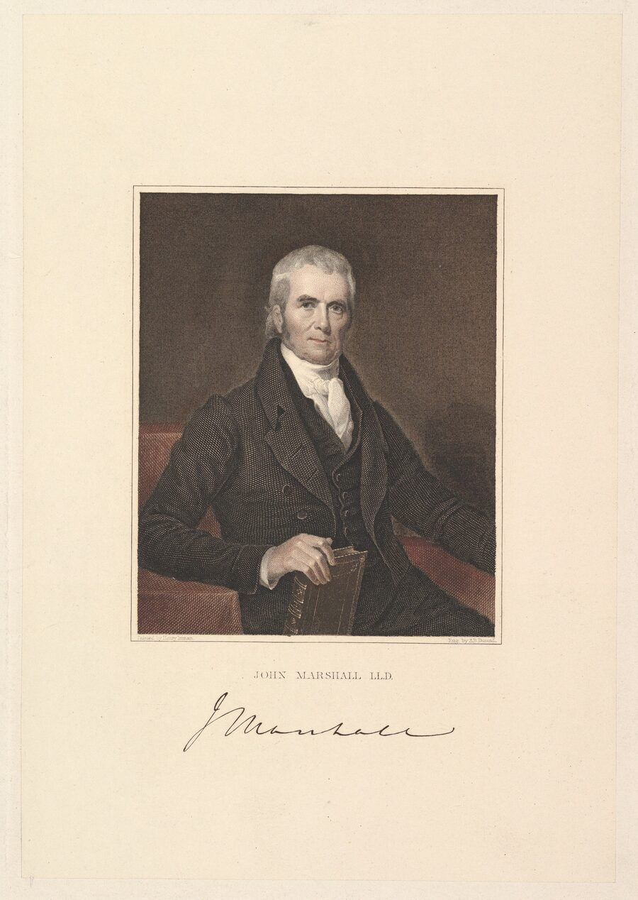
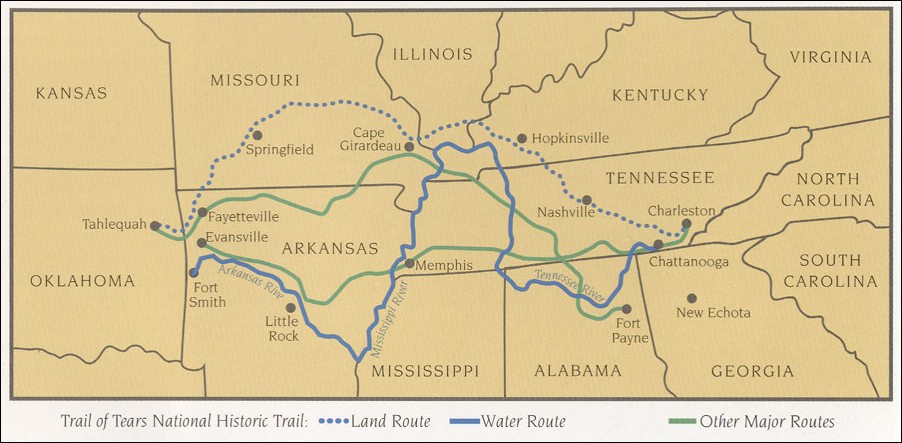

# 9. Переселение и договоры (1815–1860)

> **Статус:** черновик.

[Глава 8](08-epoha-balansa.md) закончилась 1815 годом: последний противовес
упал, и республика, которой больше не с кем было балансировать, сменила
язык. Эта глава — о полувеке, когда договор остался, а союз исчез: договоры
превратились в инструмент изъятия земли, а несогласных удаляли силой за
Миссисипи. Это мост между тезисами № 5 и № 7: вытеснение готовит «синхронный
финал» [главы 10](10-sinhronnyj-final.md).

Короткий итог проверки. Машина работала в три хода. Первый — договор:
поколение подписей, оформленных как продажа, но подписанных под давлением
армии и долга. Второй — суд: три решения Верховного суда («трилогия
Маршалла») одновременно признали коренные народы «обособленными сообществами»
и лишили их права на землю как собственности. Третий — штык: закон о
переселении 1830 г. и «Тропа слёз». Ирония, которую отмечают все историки
права: именно юридическая конструкция, созданная для обоснования изъятия,
через полтора века станет опорой возвращения суверенитета — об этом
[глава 12](12-vozvrashchenie.md).

## Договорная машина

Договорная система США — сотни документов за девяносто лет. Реестр, который
составил Чарльз Ройс для Бюро американской этнологии (1899), хронологизирует
все земельные цессии и резервации страны — его расписание доходит до номера
705, от договора в форте Стануикс с шестью нациями (22 октября 1784 г.) до
актов 1894 г.[^royce1899] Каждый договор шёл через Сенат; на местах всем
заправляли агенты Бюро по делам индейцев — перепись 1890 г. писала об их
власти без обиняков: агенты — «фактически феодальные лорды» на своих
территориях.[^donaldson1894] В 1871 г. Конгресс положил периоду конец: «ни
одна индейская нация или племя в пределах территории Соединённых Штатов не
будет признана или рассматриваема как независимая нация, племя или держава» —
при этом все прежние договоры сохранили силу.[^usc25-71] Формула важна
дважды: она закрывала эпоху равных договоров — и оставляла в силе их тексты,
к которым можно будет апеллировать.

## Чероки: письменная нация под ударом

К 1820-м гг. чероки сделали всё, что США называли цивилизацией. Слоговая
азбука Секвойи (1821 г.) дала письменность за одно поколение;[^unseth2016] с
1828 г. в Нью-Эчоте выходила двуязычная газета «Cherokee Phoenix»; в 1827 г.
нация приняла конституцию с тремя ветвями власти. Та же нация владела
плантациями и рабами: перепись Хендерсона 1835 г., поданная федеральному
комиссару, нашла 16 542 чероки, 201 «перемежающегося белого» и 1592 чёрных
рабов.[^nara-m1773] Аккультурация не спасла — возможно, она и сделала
изъятие заманчивым: в 1828–1829 гг. в Джорджии нашли золото, и штат законами
1829–1830 гг. разложил власть чероки: их законы аннулировались, а «ни один
индеец или потомок индейца не считается правоспособным свидетелем в суде
этого штата, где стороной может быть белый» (акт воспроизведён в материалах
Верховного суда США).[^worcester1832]

## Трилогия Маршалла

Судьба чероки трижды доходила до Верховного суда, и все три решения написал
один человек — председатель Джон Маршалл (рисунок 9.1).

<picture></picture>

**Рис. 9.1.** Джон Маршалл, председатель Верховного суда США (1801–1835).
Портрет Генри Инмана, 1832 г. — написан ровно в год третьего решения
трилогии. *Первоисточник:* Henry Inman, 1832; Метрополитен-музей, CC0;
изображение уменьшено.[^marshall1832]

<picture>
  <source media="(prefers-color-scheme: dark)" srcset="img/09-marshall-trilogy-dark.svg">
  
</picture>

**Рис. 9.2.** Трилогия Маршалла и конец договорного периода. *Данные:* тексты
решений (Justia) и 25 U.S.C. § 71; цитаты дословные, с. указаны в данных
[data/removal.json](../data/removal.json).

**1823.** *Johnson v. M'Intosh* узаконило «доктрину открытия»: земля,
«открытая» европейской державой, принадлежит её государству-правопреемнику;
коренные жители — «законные оккупанты», но продавать землю могут только
государству. «Завоевание даёт титул, который суды завоевателя не могут
отрицать», — пишет Маршалл и сам признаёт, что это принцип не права, а
силы.[^johnson1823]

**1831.** *Cherokee Nation v. Georgia*: чероки просили суд остановить
законы Джорджии — и получили отказ: они не «иностранное государство» в смысле
Конституции. «Скорее их можно назвать внутренними зависимыми нациями»,
а отношения с США «похожи на отношения подопечного к опекуну».[^cherokee1831]
Опека — слово, которое вернётся в XX в. и в политике, и в судах.

**1832.** *Worcester v. Georgia* решил противоположное: законы Джорджии в
стране чероки «не имеют силы», нация чероки — «обособленное сообщество,
занимающее свою территорию».[^worcester1832] Приписываемую Джексону фразу
«Джон Маршалл решил так; посмотрим, как он это исполнит» историки считают
апокрифом — она появилась спустя десятилетия;[^miles1973] но исполнение
действительно не последовало: Вустер вышел из тюрьмы по прокламации
губернатора, а удаление чероки это не остановило.[^worcester1832]

## Закон о переселении и «Тропа слёз»

28 мая 1830 г. Конгресс принял закон «об обмене землями с индейцами» —
президент получил право менять земли восточных народов на земли к западу от
Миссисипи; оговорка «ничто в этом акте не должно истолковываться как
разрешающее нарушение действующих договоров» осталась на бумаге.[^removalact1830]
По сводке Национального архива, администрация Джексона заключила затем почти
70 договоров о переселении: почти 50 000 восточных индейцев переехали, 25
млн акров открылись для поселенцев.[^nps-trte]

<picture></picture>

**Рис. 9.3.** Маршруты удаления восточных народов — карта Службы
национальных парков по материалам национального исторического маршрута
«Тропа слёз». *Первоисточник:* NPS; Wikimedia Commons, общественное
достояние (США); снимок уменьшен.[^npstrailmap]

Первым в 1831–1833 гг. удалили чокто; вожак одной из партий, по преданию,
назвал путь «тропой слёз и смерти» — так стали звать всё переселение.[^faimansilva1997]
Маскоги шли в 1834–1837 гг. — 19 600 человек по Торнтону, около 4500
погибших по оценке Остлера;[^thornton1991][^ostler2015] семинолы ответили
войной 1835–1842 гг. — самой долгой и дорогой индейской войной США.[^nps-trte]
Чероки высылали последними, в 1838–1839 гг.: более 16 000 человек, армия,
лагеря, четырнадцать отрядов; «больше тысячи чероки — особенно старики,
дети и немощные — умерли в пути на запад», а после приезда — «неизвестное
число, возможно, несколько тысяч» — это данные Службы национальных парков;
в литературе общий счёт погибших идёт от двух до восьми тысяч.[^nps-trte]
Оценка Остлера — около пяти тысяч.[^ostler2015]

## Мексика, Канада, юг: тот же полувек

На севере Мексики те же годы выглядели иначе: ослабленное государство само
стало объектом набегов (об этом — [глава 4](04-perehodnaya-zona.md)). Когда
в 1840 г. в Сан-Антонио команчи приехали выкупать пленных, техасцы
расстреляли парламентёров — тридцать вождей и воинов пенатека; резня в
«Советном доме» открыла десятилетие взаимных войн.[^schilz1995] А в 1848 г.
США, забрав у Мексики север, взяли и её «индейский вопрос»: статья XI
договора Гуадалупе-Идальго обязала США «силой сдерживать» набеги «диких
племён» — но команчей и кайова это не касалось: они не признавали над собой
никакой власти и воевали теперь с новой, куда более сильной.[^delay2008]

В Канаде договоры покупали, а не ломали: в 1850 г. Уильям Робинсон купил у
оджибве северные берега Верхних озёр — «добровольно уступают, отчуждают,
дарят и передают её величеству все их права, титулы и интересы», с
пожизненной рентой;[^robinson1850] комиссия Баго (1842–1844) рекомендовала
то, что вырастет в систему школ-интернатов, — об этом
[глава 11](11-assimilyaciya.md).[^leslie1982] У мапуче республика Чили
продолжила практику парламентов: Тапиуэ (1825) подтвердил границу по
Био-Био — наследие колониального баланса жило дольше самого баланса
([глава 8](08-epoha-balansa.md)).[^bengoa1985]

## Вывод

Мост между тезисами № 5 и № 7 оказался короче, чем кажется. Потеряв
противовесы, восточные народы потеряли землю за одно поколение — даже те,
кто сделал всё «по правилам»: чероки имели письменность, конституцию, газету
и газетную перепись — и прошли «Тропу слёз» первыми из последних. Судебная
конструкция «внутренних зависимых наций» сработала как машина: доктрина
открытия отняла землю, опека — субъектность. Но документы остались, и
именно они — договоры с оговоркой 1871 г. о сохранении силы, решения
Маршалла об «обособленных сообществах» — через век станут фундаментом
обратного движения ([глава 12](12-vozvrashchenie.md)).

| Утверждение | Что показывают источники | Итог |
|---|---|---|
| Договоры стали инструментом изъятия | реестр Ройса: 705 цессий за 110 лет; 70 договоров о переселении при Джексоне | держится |
| Аккультурация спасает от удаления | чероки: азбука, газета, конституция — и «Тропа слёз»; перепись 1835 г. с рабами как «имущество» нации | нет: не спасла |
| Суд защитил народы | трилогия: «завоевание даёт титул…» (1823), «подопечный и опекун» (1831) — и «обособленное сообщество» (1832), не исполненное | суд защитил конструкцию, а не людей |
| Переселение было «добровольным обменом» | закон 1830 г. с оговоркой о договорах — и 16 000 чероки под конвоем; 1000+ погибших в пути (NPS) | нет: договорная форма, силовое содержание |
| Это только американская история | Мексика слабеет под набегами (гл. 4); Канада покупает (Робинсон 1850); Чили договаривается (Тапиуэ 1825) | общая механика, разные инструменты |

Что может измениться. Числа погибших при удалениях расходятся в разы —
конспект приводит их с авторами; при доступе к монографиям Торнтона и Махона
их следует сверить. Судебные цитаты выверены по текстам решений (Justia).
Роль рабства внутри «пяти племён» здесь только намечена переписью 1835 г. —
для её разбора нужен отдельный источник.

Дальше — [глава 10](10-sinhronnyj-final.md): запад. Мобильные народы, которые
триста лет уходили от государств, встречают десятилетие, когда уходить
стало некуда: железные дороги, магазинные винтовки и мировые цены на шкуры
доходят до равнин одновременно.

## Источники

[^royce1899]: Royce 1899, расписание цессий (полный текст, Internet Archive).
[^donaldson1894]: Donaldson 1894, раздел «Indian Reservations and Agents», с. 91 (полный текст, Internet Archive).
[^usc25-71]: 25 U.S.C. § 71 (полный текст, Cornell LII).
[^unseth2016]: Unseth 2016, аннотация и метаданные (текст недоступен).
[^nara-m1773]: NARA, Eastern Cherokee Census Rolls M1773, раздел о переписи 1835 г. (полный текст памфлета).
[^worcester1832]: Worcester v. Georgia, 31 U.S. 515: акты Джорджии — с. 521–528, мнение — с. 556–563 (полный текст, Justia).
[^johnson1823]: Johnson v. M'Intosh, 21 U.S. 543, с. 572–592 (полный текст, Justia).
[^cherokee1831]: Cherokee Nation v. Georgia, 30 U.S. 1, с. 16–20 (полный текст, Justia).
[^miles1973]: Miles 1973 (только описание; атрибуция фразы Джексона — по разборам, включая «They Never Said It»).
[^marshall1832]: Inman 1832 (изображение; Метрополитен-музей, CC0).
[^removalact1830]: Indian Removal Act 1830 (полный текст репринта, Teaching American History).
[^nps-trte]: NPS, Trail of Tears National Historic Trail (полный текст; сводка NARA Our Documents № 25).
[^faimansilva1997]: Faiman-Silva 1997, с. 19 (фрагмент, поиск по книге).
[^thornton1991]: Thornton 1991 (только описание).
[^ostler2015]: Ostler 2015 (фрагмент: цитата в открытых сводках).
[^schilz1995]: Schilz, «Council House Fight», Handbook of Texas (полный текст).
[^delay2008]: DeLay 2008 (только описание; ст. XI — по тексту договора, гл. 4).
[^robinson1850]: Robinson Treaties 1850 (текст в открытых сводках правительства Канады).
[^leslie1982]: Leslie 1982 (только описание).
[^bengoa1985]: Bengoa 1985 (только описание).
[^npstrailmap]: NPS, карта маршрутов удаления (изображение; Wikimedia Commons, общественное достояние США).
