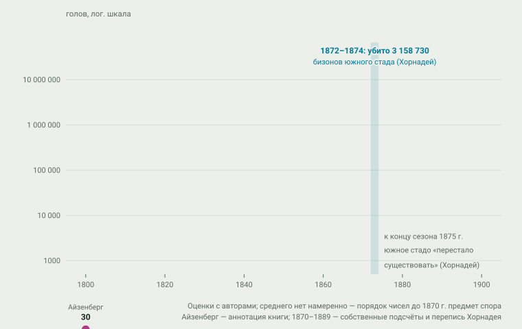
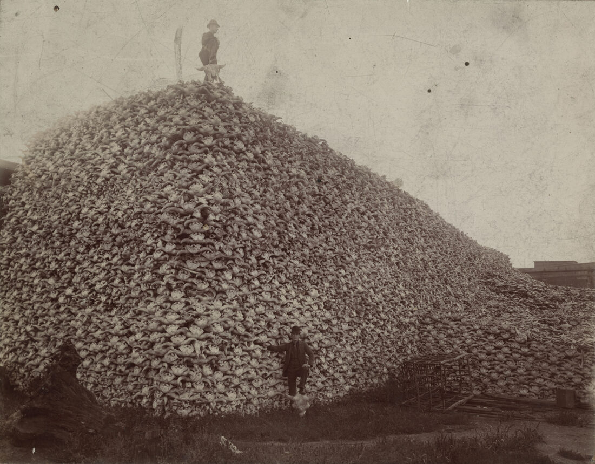
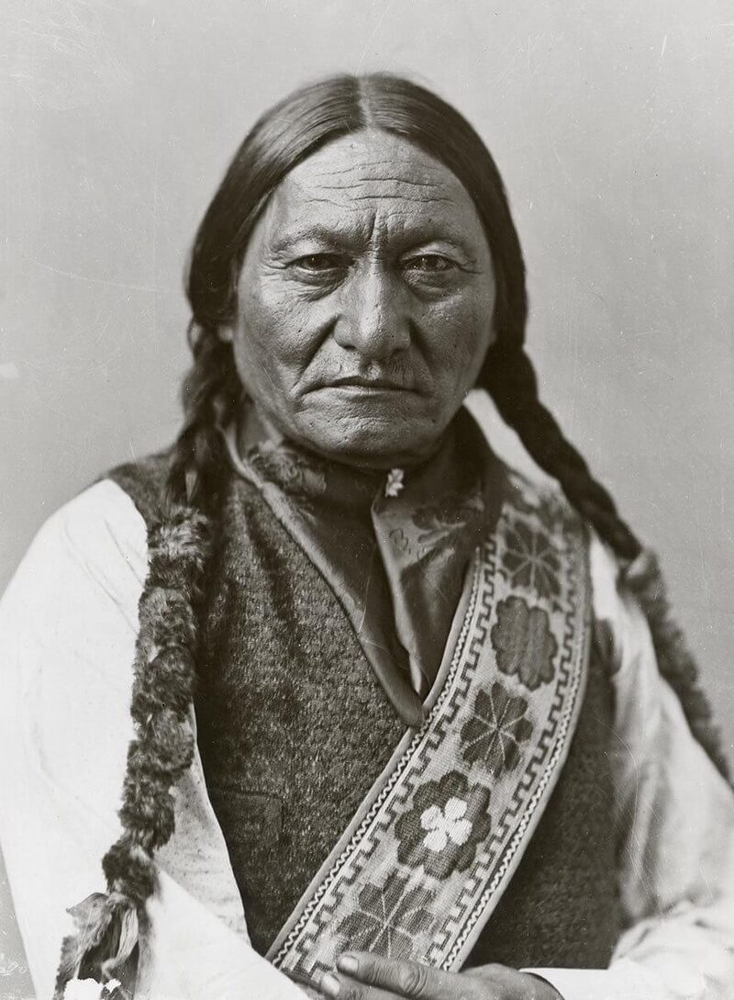
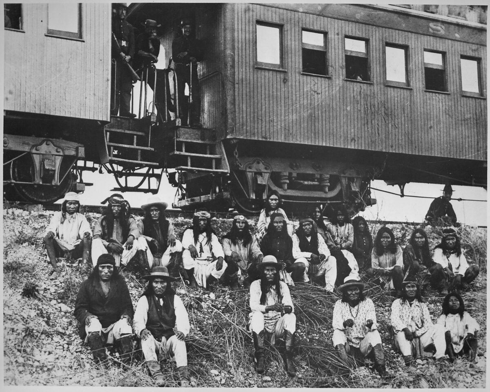

# 10. Синхронный финал (1875–1885)

> **Статус:** черновик.

[Глава 9](09-pereselenie.md) выселила восточные народы за Миссисипи; [глава
7](07-loshad-i-ruzhyo.md) показала, на чём держатся конные культуры запада —
на бизоне и лошади. Эта глава — о десятилетии, когда всё это кончилось сразу
везде: на равнинах США и Канады, в Араукании и на пампе. Опорный тезис
конспекта № 7 говорит: последние независимые мобильные народы были покорены
индустриальными государствами за одно десятилетие — не случайно, а по общим
причинам: армии, железные дороги, магазинные винтовки, телеграф и мировой
рынок, съевший их кормовую базу.

Короткий итог проверки. Синхронность — факт: капитуляции Куаны Паркера
(1875) и Джеронимо (1886), разгром 1885-го в Канаде, «решённая проблема»
Араукании (1883) и «Завоевание пустыни» (1879–1885) ложатся на одно
десятилетие. Но причинность — «оценка», как и требует методика: общие причины
налицо, а их общий вес каждая страна добавляла по-своему. И главное: финал
готовился не только армиями. Кормовую базу конных культур уничтожил рынок —
шкура бизона стала товаром за десять лет до того, как солдаты пришли за
последними охотниками.

## Бизон: база, съеденная рынком

Всё держалось на бизоне — и всё в нём было товаром: мясо, шкуры на robes,
кожа для ремней промышленных машин. Числа знает не по документам никто, но
два историка стали здесь классикой. Эндрю Айзенберг: около 30 млн бизонов к
1800 г. — и меньше тысячи к 1900-му.[^isenberg2000] Уильям Хорнадей,
натуралист, который в 1889 г. лично провёл перепись остатков: на 1 января
1889 г. во всей стране 1091 живой бизон — 85 диких в США, 550 в Атабаске (по
оценке), 256 в неволе и 200 в Йеллоустоне.[^hornaday1889]

<picture>
  <source media="(prefers-color-scheme: dark)" srcset="img/10-bison-dark.svg">
  
</picture>

**Рис. 10.1.** Бизоны: оценки с авторами, 1800–1900. *Оценки:* Айзенберг —
аннотация его книги; ряд 1870–1889 — собственные подсчёты и перепись
Хорнадея (полный текст); шкала логарифмическая, среднего нет намеренно —
даже порядок чисел до 1870 г. предмет спора.

Южное стадо убила шкура. Железная дорога Atchison, Topeka & Santa Fe, по
сведениям, которые приводит Хорнадей, вывезла 165 721 шкуру за 1872 г.,
251 443 за 1873-й и 42 289 за 1874-й; полковник Додж научил счёту: одна
шкура 1872 года означала трёх убитых бизонов — шкуры на типи и одежду в
товар не шли. По пересчёту Хорнадея, за три года белые охотники убили
3 158 730 бизонов южного стада, и «к концу охотничьего сезона 1875 г.
огромное южное стадо перестало существовать».[^hornaday1889] Оружие и
экономику охоты описал очевидец — охотник Джон Кук: «большие пятидесятые»
Шарпса, стрелявшие на полторы тысячи шагов; фраза генерала Шеридана,
которую Кук вспоминает с одобрением офицеров: «уничтожьте бизонов — и будет
прочный мир».[^cook1907] Конгресс в 1874 г. успел принять закон об охране
бизонов — президент Грант положил его «под сукно».[^hornaday1889]

<picture></picture>

**Рис. 10.2.** Гора черепов у завода Michigan Carbon Works (ок. 1892):
кость шла на удобрение и уголь для фильтров. Это не battlefield, а склад
сырья — фотография конца цепочки, начатой «большими пятидесятыми».
*Первоисточник:* фото ок. 1892 г., Burton Historical Collection; Wikimedia
Commons, общественное достояние; снимок уменьшен.[^skullpile1892]

> [!NOTE]
> **Оценка.** Айзенберг против однолинейного рассказа «белые застрелили
> всех»: катастрофу делали вместе «конные индейские номады и промышленные
> заготовители» на фоне засух; конная охота сама давила на стада, а
> перевыпас долин лошадьми (гл. 7) к 1840-м подтолкнул их «в ранний
> упадок».[^isenberg2000][^egp] Для главы это важно: базу конных культур
> подтачивали изнутри и снаружи — армия лишь довела дело до конца.

## США: три кампании

**Война на Ред-Ривер (1874–1875).** Толчок дали сами охотники: у Эдоуби-Уоллс
27 июня 1874 г. около семисот воинов команчей, кайова, шайеннов и арапахо
напали на 28 охотников — и проиграли осаду.[^adobewalls2020] Армия ответила
пятью колоннами; в Пало-Дуро 28 сентября солдаты Маккензи сожгли деревни и
закололи больше тысячи пони — «убив лишь двух-трёх индейцев», как честно
пишет справочник Техаса: били не по людям, по хозяйству.[^haley2020] 2 июня
1875 г. последние свободные команчи — квахади Куаны Паркера — сдались в
Форт-Силл; несколько десятков вождей отправили в ссылку во Флориду, в
Форт-Мэрион (по разным сводкам — от 71 до 74 человек).[^haley2020][^nps-casa]

**Великая война сиу (1876–1877).** Повод — золото Блэк-Хиллс: экспедиция
Кастера 1874 г. нашла его в землях, отданных договором 1868 г. (о договорах этой эпохи — [глава 8](08-epoha-balansa.md)) «столько,
сколько травы» — репорт о находке есть в официальном отчёте инженера
Ладлоу.[^ludlow1875] Дальше — Литтл-Бигхорн (25–26 июня 1876 г.): полк в
походе — 31 офицер и 566 рядовых, у Кастера — около 210; численность
индейского лагеря оценивают от 800 до 2500 воинов — по сторонам до сих
пор.[^sioux1980] Битву сиу и шайенны выиграли, войну — нет: зимой армия
отбирала лошадей и бизонов; в 1877 г. Конгресс конфисковал Блэк-Хиллс
актом от 28 февраля. Спустя сто три года Верховный суд признал изъятие
«более спелым и тухлым случаем бесчестного обращения» и присудил
компенсацию — 17,1 млн долларов с процентами; лакота деньги не взяли до
сего дня.[^sioux1980] Сидящий Бык увёл людей в Канаду (о его судьбе до сдачи в 1881 г. — по сводкам); в 1885 г. он, как ни дико это звучит, гастролировал с шоу
Буффало Билла — фотография той поры стала портретом эпохи (рис. 10.3).

<picture></picture>

**Рис. 10.3.** Сидящий Бык в 1885 г., между Канадой и Вундед-Ни. Фото
студии Нотмана (Монреаль) — сделано во время гастролей с шоу Дикого Запада.
Через пять лет он будет убит при аресте, за две недели до Вундед-Ни (о
котором — [глава 11](11-assimilyaciya.md)). *Первоисточник:* Notman & Son,
1885; Wikimedia Commons, общественное достояние.[^notman1885]

**Не-персе (1877) и апачи (1886).** Отступление не-персе длилось 126
дней и кончилось 5 октября 1877 г. у Медвежьей Лапы:, «всего сорок миль не
доходя до канадской границы», их настиг полковник Майлз — 450 солдат за
девять дней пути; в ту же ночь с вождем Белой Птицей ушли последние из
200–300 человек, прорвавшихся в Канаду.[^nps-bearpaw] Против последней группы
Джеронимо — тридцать пять воинов, восемь мальчиков, сто одна женщина —
работали «не меньше пяти тысяч солдат и пятисот индейских скаутов»;
4 сентября 1886 г. он сдался у Скелет-Каньона, обещание вернуть соплеменников
в Аризону исполнено не было — пленных увезли во Флориду (рис. 10.4).[^nara530797]

<picture></picture>

**Рис. 10.4.** Пленные чирикауа, среди них Джеронимо, по дороге из Аризоны
во Флориду, 1886. Последняя независимая группа Аризоны ехала в вагоне —
железная дорога работала и как оружие. *Первоисточник:* фото военного
ведомства США, NARA 530797; Wikimedia Commons, общественное достояние
(США); снимок уменьшен.[^nara530797]

## Канада: бизоны, договоры, голод

В Канаде та же история шла без больших войн — через голод. Бизоны канадских
равнин исчезли к началу 1880-х; ещё в 1880 г. комиссар Моррис предупреждал в
книге о договорах: «скоро бизоны будут истреблены, и когда придёт голод,
племена равнин обратятся за помощью к фортам».[^morris1880] Правительство
заключало договоры заранее: Договор 6 (1876) содержал пункты, которых не
было в соседних, — «у дома каждого индейского агента хранится медицинский
сундук» и помощь «при моровом поветрии или всеобщем голоде» — текст писал
сам Моррис.[^morris1880] Дашук показал дальше: в 1880-е помощь выдавали как
оружие — «политика голода» против кри и ассинибойнов; книга конспекту
недоступна, и это честная отметка.[^daschuk2013] Весной 1885 г. голод и
земельная тревога метисов и кри взорвались восстанием на Саскачеване: у
Баточа около восьмисот правительственных солдат разбили около трёхсот
повстанцев; Луи Риэль был повешен 16 ноября 1885 г. — год «синхронного
финала» закрылся виселицей и в Канаде.[^daschuk2013]

## Чили и Аргентина: два «завоевания» на юге

**Чили** перенимал Арауканию тридцатью годами методичной оккупации. План
Сааведры — линия фортов по реке Мальеко, города, дороги, телеграф —
исполнялся с 1862 г.; Темуко основан в феврале 1881-го, Вильяррика — 1 января
1883-го; 1 июня 1883 г. президент Санта-Мария объявил «проблему
сокращения всей Араукании решённой».[^canales2022][^bengoa1985] Мапуче
свели в редукции по «титулам милости»: с 1884 по 1929 г. земельные комиссии
выдали 2918 титулов на 510 386 га для 82 629 человек — около шести гектаров
на человека.[^canales2022] Парламентов больше не было: вопрос перешёл из
дипломатии в землеустройство.

**Аргентина** решила вопрос юга кампанией. «Завоевание пустыни» генерала
Роки (1879–1885) шло шестью тысячами солдат с новыми казнозарядными
ремингтонами; по официальным сводкам, которые пересказывает историография, —
1313 убитых индейцев и больше пятнадцати тысяч пленных.[^escolar2018]
Судьба пленных — отдельная страница: в Мендосе за 1878–1889 гг. «не меньше
трёх тысяч человек — преимущественно стариков, женщин и детей» были
распределены «как фактические рабы» по домам; 386 крещений, около трёх
четвертей — младше двадцати лет.[^escolar2018] Последняя большая группа —
свыше трёх тысяч воинов Инакаяля и Фойеля — сдалась в декабре 1884 г.;
через год лето 1885-го закрыло и аргентинский финал.[^escolar2018]

<picture>
  <source media="(prefers-color-scheme: dark)" srcset="img/10-sync-dark.svg">
  
</picture>

**Рис. 10.5.** Синхронный финал одной шкалой: четыре страны. *Данные:* из
[data/frontier.json](../data/frontier.json) со ссылками; полоса-фон — то самое
десятилетие тезиса № 7; чилийская полоса начинается левее шкалы — оккупация
шла с 1862 г.

## Общие причины — и проверка синхронности

Что общего у всех четырёх финалов? Кандидаты перечислены в тезисе, и каждый
проверяется.

*Армии.* США воевали ветеранами Гражданской; Чили вела параллельно
Тихоокеанскую войну 1879–1884 гг.; аргентинские командиры выросли в
Парагвайской. Все четыре государства к 1880-м имели постоянные армии
промышленной эпохи — против них воевали отряды в сотни человек.

*Оружие.* Однозарядные «трапдоры» Спрингфилда образца 1873 г. — и
многозарядные винтовки у самих индейцев: под Литтл-Бигхорном не меньше двух
сотен воинов были с «Генри» и «Винчестерами» — техническое превосходство
было не всегда на стороне армий.[^sioux1980] Охотников вооружали «большие
пятидесятые» Шарпса,[^cook1907] аргентинскую пехоту — ремингтоны; суть
одна: магазинное и дальнобойное оружие удешевило войну против мобильного
противника.

*Железные дороги и телеграф.* Дороги подвозили охотников и солдат и вывозили
шкуры — весь шкуряной бум 1872–1874 гг. стоял на ветках Kansas Pacific и
Atchison; пленных чирикауа увезли во Флориду по рельсам. Телеграф входил и в
план Сааведры, и в планы американских фортов — синхронная война требовала
синхронной связи.

*Мировой рынок.* Шкура стала товаром (рис. 10.1); шерсть патагонских овец и
мясо пампы — тоже: в 1876 г. первый рефрижераторный корабль довёз
охлаждённую говядину из Аргентины в Европу, и земля пампы получила цену,
которой не было при «диких индейцах». Даты холодильных рейсов конспект
приводит по сводкам — для них нужен отдельный источник.

> [!IMPORTANT]
> **Гипотеза конспекта.** Синхронность финала — не совпадение, но и не
> заговор: четыре государства независимо друг от друга прошли порог
> индустриальной мобилизации, а мировой рынок независимо от них назначил
> цену земле, на которой жили последние независимые народы. Проверить
> причинность строго — значит показать, что без каждой из общих причин
> финал не случился бы; источников для такого расчёта нет, и это честная
> граница: тезис остаётся оценкой, хорошо подкреплённой хронологией.

## Вывод

| Утверждение (тезис № 7 и его версии) | Что показывают источники | Итог |
|---|---|---|
| Финал синхронен | 1875 (Паркер), 1877 (Джозеф, Блэк-Хиллс), 1883 (Араукания «решена»), 1884–1885 (Инакаяль, Батош), 1886 (Джеронимо) | держится: десятилетие |
| Экономическая база уничтожена рынком | 3 158 730 бизонов за 1872–1874 (Хорнадей); 1091 голова к 1889; овцы и мясо пампы | держится |
| Причины общие: армии, дороги, винтовки, рынок | у всех четырёх стран — да; но веса разные (Чили — forts и землеустройство; Аргентина — кампания и рабские распределения) | оценка с хорошей хронологией |
| Мобильность перестала спасать | лошадей отбирали целенаправленно (Пало-Дуро >1000 пони; канадские конфискации) | держится: били по базе, не по людям |
| Индустриальные государства действовали одинаково | США — резервации; Канада — договоры с голодом; Чили — редукции; Аргентина — распределение пленных «как фактических рабов» | инструменты разные, цель одна: землю без народа |

Что может измениться. Числа бизонов до 1870 г. — предмет спора; перепись
Хорнадея — первична, но охватывает выживших, не погибших. Числа пленных и
убитых у Роки — официальные сводки в историографической передаче; для
Канады нужна книга Дашука. Судьба компенсации Блэк-Хиллс (отказ лакота
принять деньги) — живой сюжет: сумма растёт с процентами и на 2020-е
превышает миллиард долларов — это уже [глава 12](12-vozvrashchenie.md).

Дальше — [глава 11](11-assimilyaciya.md): покорённые народы ждёт политика,
меняющая цель: теперь уничтожать будут не людей, а народы как сообщества —
землю разделят на участки, а детей увезут в школы-интернаты.

## Источники

[^isenberg2000]: Isenberg 2000 (аннотация; полный текст недоступен).
[^hornaday1889]: Hornaday 1889: перепись живых (таблицы 1889 г.); «Statistics of the slaughter» (дорога AT&SF; метод Доджа; 3 158 730); «южное стадо перестало существовать»; раздел о Коди; раздел о законе 1874 г. (полный текст, Project Gutenberg № 17748).
[^cook1907]: Cook 1907, гл. XX: «большие пятидесятые»; слова Шеридана «уничтожьте бизонов — и будет прочный мир» (полный текст, archive.org).
[^skullpile1892]: Гора черепов, ок. 1892 (изображение; Burton Historical Collection; Wikimedia Commons, общественное достояние).
[^adobewalls2020]: «Adobe Walls», Handbook of Texas (полный текст).
[^haley2020]: Haley, «Red River War», Handbook of Texas (полный текст).
[^nps-casa]: NPS, Castillo de San Marcos: Stories (полный текст).
[^ludlow1875]: Ludlow 1875, запись 30 июля 1874 г. о находке золота (полный текст, archive.org).
[^sioux1980]: United States v. Sioux Nation, 448 U.S. 371 (полный текст, Cornell LII; числа сторон — по сводкам с оговоркой о расхождении оценок).
[^nps-bearpaw]: NPS, Bear Paw Battlefield (полный текст).
[^notman1885]: Notman & Son 1885 (изображение; Wikimedia Commons, общественное достояние).
[^nara530797]: NARA 530797 (изображение; Wikimedia Commons, общественное достояние США); детали кампании против Джеронимо — по статье Britannica «Geronimo» (полный текст).
[^morris1880]: Morris 1880: введение («скоро бизоны будут истреблены…»); текст Договора 6 («медицинский сундук», помощь при голоде) (полный текст, archive.org).
[^daschuk2013]: Daschuk 2013 (только описание).
[^canales2022]: Canales Tapia 2022: даты оккупации и «решённая проблема»; редукции: 2918 титулов, 510 386 га, 82 629 человек (полный текст).
[^bengoa1985]: Bengoa 1985 (только описание).
[^escolar2018]: Escolar & Saldi 2018: «distributed as virtual slaves no fewer than three thousand people»; крещения; кампания Роки и числа пленных (полный текст; сводные числа Роки — в историографической передаче).
[^egp]: Encyclopedia of the Great Plains, статья «Horse» (Hämäläinen) (полный текст).
