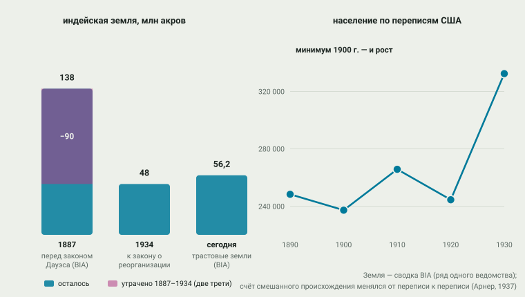
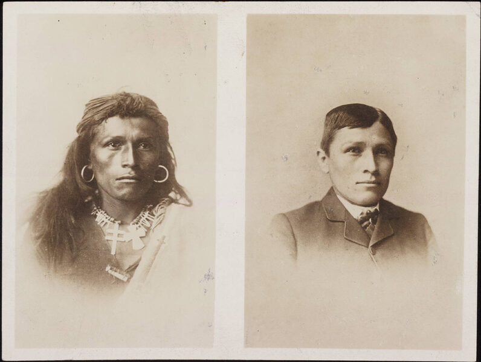
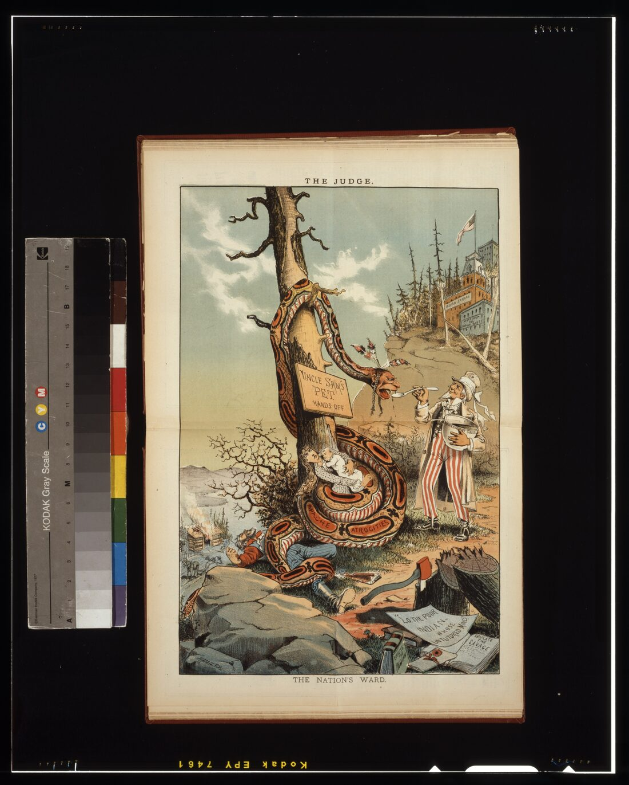

# 11. Ассимиляция

> **Статус:** черновик.

[Глава 10](10-sinhronnyj-final.md) закончилась капитуляциями. Эта глава — о
политике, которая пришла на смену войне: цель сменилась с «устранить людей»
на «растворить народы». Два главных инструмента известны: раздел общинной
земли на частные участки ([аллотмент](../glossary.md#аллотмент)) и воспитание
детей вне семьи и языка — школы-интернаты. Оба работали в одну сторону:
община, потерявшая землю и язык, переставала быть общиной. Опорный тезис № 8
в первой части: земельная база при этом сокращалась не вопреки политике, а
благодаря её механике.

Короткий итог проверки. Тезис держится на числах самого правительства США:
138 млн акров индейской земли в 1887 г. — 48 млн к 1934-му.[^bia-policy]
Школьная система измерена официально лишь в наши дни: 408 школ-интернатов
(доклад Министерства внутренних дел, 2022), 417 школ и не меньше 973
задокументированных детских смертей (том 2, 2024).[^newland2022][^newland2024]
Но глава показывает и третье: политика провалилась. Языки, родственные сети
и религиозные движения пережили её — а следующая,
[глава 12](12-vozvrashchenie.md), будет о том, как выжившие вернули себе право.

## Аллотмент: общую землю — в частные участки

Закон Дауэса (8 февраля 1887 г.) выглядел реформой: каждый индеец получал
участок — «главе семьи — четверть секции» (160 акров), одинокому старше
восемнадцати — одну восьмую, прочим — одну шестнадцатую, — а с участком и
гражданство США.[^dawes1887] Продавалось другое: «нераспределённые части
резервации» министр внутренних дел выкупал у племени и пускал в продажу
поселенцам.[^dawes1887] Именно эта механика и съела землю: общинное
землевладение объявлялось «неиспользуемым», а капитал от продажи исчезал в
счетах опеки. Закон Берка (1906) добавил ускоритель: министр мог выдать
«компетентному» индейцу патент полной собственности — «и с этого момента
все ограничения на продажу, обременение и налогообложение этой земли
снимаются».[^burke1906] Дальше работали налоги штатов и принудительные
продажи за неуплату — государство само признаёт это каналом утраты
земли.[^bia-policy]

<picture>
  <source media="(prefers-color-scheme: dark)" srcset="img/11-land-dark.svg">
  
</picture>

**Рис. 11.1.** Земля и люди в эпоху ассимиляции. *Данные:* земля — сводные
цифры BIA[^bia-policy][^bia-faq] (ряд из одного источника; академическая
классика — Otis 1973 — конспекту недоступна); население — переписи США по
подсчёту Арнера (1930 г.): сам Арнер предупреждал, что темпы роста
«мало значимы», потому что всё зависит от того, как счётчики учитывали
смешанное происхождение.[^arner1937]

Положил конец аллотменту закон о реорганизации 1934 г. — первая строка
прямым текстом: «с этого времени ни земля какой-либо индейской резервации…
не будет распределяться в частные участки», трастовые периоды
продлеваются, «остаточные» земли возвращаются племенам.[^ira1934] О том,
что выросло из этой реорганизации, — [глава 12](12-vozvrashchenie.md).

## Школы: ребёнка — из семьи

«Убей в нём индейца — и сохрани человека». Формула принадлежит Ричарду
Пратту, основателю школы-интерната в Карлайле (1879), и сказана в 1892 г.
без всякого стеснения — в докладе благотворительной конференции, где Пратт
соглашался с поговоркой «хороший индеец — мёртвый индеец» и пояснял: мёртвым
должно быть «всё индейское в этой расе».[^pratt1892] Практика была той же
логики: стрижка волос, запрет языка, чужое имя, труд по расписанию. Парные
снимки «до и после» были частью пиара системы (рис. 11.2).

<picture></picture>

**Рис. 11.2.** Том Торлино (навахо), школа Карлайл, около 1882 г. Парные
снимки «до и после» печатались как реклама системы: разница читалась как
«успех». Сама школа работала на бывшей военной базе — преемственность
здания и метода. *Фото:* John N. Choate; Wikimedia Commons, общественное
достояние; снимок уменьшен.[^torlino1882]

Масштаб системы правительство США впервые само подсчитало только в 2020-е.
Доклад Федеральной инициативы по школам-интернатам (том 1, 2022): с 1819 по
1969 г. США содержали или поддерживали 408 школ-интернатов в 37 штатах, при
них — «не меньше 53 мест захоронения детей».[^newland2022] Том 2 (2024)
уточнил: список доведён до 417 школ, подтверждены «не меньше 973» смертей
детей в этих школах, поимённо идентифицировано 18 624 ребёнка, вошедших в
систему, — с прямой оговоркой, что учёт неполон.[^newland2024]

В Канаде ту же систему признала Комиссия по установлению истины и
примирению: через residential schools прошло «не меньше 150 000» детей
Первых наций, метисов и инуитов; в итоговом отчёте (2015) вся политика
названа «культурным геноцидом».[^trc2015] Компенсации признаны за 78 748
бывших учеников; по искам о насилии (IAP) к концу 2014 г. закрыто 30 939
дел с выплатой 2,69 млрд долларов.[^trc2015] Официальное извинение
премьер-министра прозвучало в Палате общин 11 июня 2008 г.[^trc2015]

> [!NOTE]
> **Оценка конспекта.** Обе системы — американская и канадская — устроены
> одинаково: изъятие ребёнка из семьи как инструмент изъятия будущего.
> Разница в том, кто и когда счёт подвёл: Канада — комиссией примирения
> (2015), США — министерским расследованием (2022–2024), и оба счёта
> продолжаются. Числа этих отчётов — нижние границы по определению:
> архивы школ неполны, а «не меньше» — часть официальной формулировки.

## Гражданство без голоса

2 июня 1924 г. все некомпетентные-граждане индейцы, рождённые в пределах
США, были объявлены гражданами — с оговоркой, что это «не должно никоим
образом затрагивать права на племенную или иную собственность».[^citizenship1924]
Голосование закон не дал: избирательные права оставались в руках штатов, и
Аризона дотянула до 1948 г., когда суд отменил её ограничения (Harrison v.
Laveen; инстанцию в открытых текстах указывают по-разному — уточнить). За
год до того карикатурист Гамильтон нарисовал «подопечного нации»: индеец на
карточке — объект благотворительности, а не гражданин (рис. 11.3).

<picture></picture>

**Рис. 11.3.** «Подопечный нации», карикатура Гранта Гамильтона (1885).
Образ подопечного — из «опеки» решений Маршалла ([глава
9](09-pereselenie.md)) — жил в политике дольше самих решений. *Первоисточник:
* Library of Congress; Wikimedia Commons, общественное достояние; снимок
уменьшен.[^hamilton1885]

## Та же политика на юге

Мексика прошла свой вариант разобщинивания раньше — законом Лердо (23 июня
1856 г.): «все сельские и городские недвижимости, которыми ныне владеют или
управляют как собственниками гражданские или церковные корпорации
Республики, передаются в собственность тем, кто их арендует».[^lerdo1856]
«Корпорации» — это и церковь, и муниципалитеты, и индейские общины-пуэбло:
общинная земля переводилась в частную одним пером. Историки спорят, насколько
закон «обездолил пуэбло»: Даниэла Марино напоминает порфириевскую статистику
— «больше 90% сельского населения работало батраками без земли», — а
Антонио Эскобар прямо ставит под вопрос гипотезу, что именно десамортизация
обездолила пуэбло.[^marino2001][^escobar2012] В Чили ту же роль сыграли
«титулы милости» после завоевания Араукании: 2918 титулов на 510 386 га для
82 629 человек ([глава 10](10-sinhronnyj-final.md)) — общинная земля мапуче
была переформатирована в наделы, удобные для продажи.[^canales2022]

## Что сохранилось вопреки

Политика растворения не растворила. По переписи 2006–2010 гг. дома в США
говорят на 169 коренных языках Северной Америки — 372 095 говорящих, самый
большой — навахо (169 471).[^siebens2011] Пляска духов 1890 г. стала
религиозным ответом на катастрофу — и была встречена пулей: 29 декабря
1890 г. у Вундед-Ни 7-й кавалерийский полк уничтожил, по оценке Службы
национальных парков, 150–300 мужчин, женщин и детей лакота.[^nps-bigfoot]
Церковь коренных американцев — пейотная церковь, инкорпорированная в 1918 г.,
— добилась в 1994 г. федеральной защиты своего таинства: Конгресс записал,
что церемониальное употребление пейота «столетиями было неотъемлемой частью
образа жизни» и защищалось нормами с 1965 г.[^airfa1994] Жили и родственные
сети: именно они, а не учреждения, вытащили языки через интернатные
десятилетия.

## Вывод

| Утверждение (тезис № 8 и его версии) | Что показывают источники | Итог |
|---|---|---|
| Аллотмент сокращал землю «по механике», а не вопреки | 138 → 48 млн акров (BIA); «излишки» в законе 1887 г.; Берка 1906 и налоги | держится |
| Школы — система, а не эксцесс | 408/417 школ; ≥973 смертей; 18 624 ребёнка поимённо (США); ≥150 000 детей, «культурный геноцид» (Канада) | держится |
| Гражданство 1924 г. всё изменило | голосование — у штатов до 1948 г. (Аризона) и позже; оговорка о племенной собственности | нет: статус без власти |
| Мексика и Чили — другие политики | закон Лердо (1856) и титулы «милости» (1884–1929): общинная земля → частные наделы | та же механика, своё законодательство |
| Ассимиляция сработала | 169 живых языков; пейотная церковь; демографический рост с 1900-х | провалилась как растворение; удалась как травма |

Что может измениться. Счёт школам-интернатам продолжается: тома 2022 и
2024 гг. сами просят пополнения («не меньше», «идентифицировано поимённо»).
Земельный ряд 138→48 — сводка одного ведомства; академический подсчёт Отиса
(1973) конспекту недоступен и должен её сверить. Демографический минимум
1900 г. — артефакт методов переписи (сам Арнер об этом предупреждал), а не
точка перелома.[^arner1937]

Дальше — [глава 12](12-vozvrashchenie.md): выжившие народы берут те же
инструменты — закон, договор, суд — и разворачивают их в обратную сторону.

## Источники

[^bia-policy]: BIA, Federal Law and Indian Policy Overview, разд. «The Allotment and Assimilation Era (1887–1934)» (полный текст).
[^bia-faq]: BIA, Frequently Asked Questions (полный текст; 56,2 млн акров, 326 резерваций, 575 племён).
[^dawes1887]: Dawes Act 1887, ст. 1, 5, 6 (полный текст, govinfo).
[^burke1906]: Burke Act 1906 (полный текст, govinfo).
[^ira1934]: Indian Reorganization Act 1934, ст. 1–3 (полный текст, govinfo).
[^pratt1892]: Pratt 1892, второй абзац доклада (полный текст, History Matters).
[^newland2022]: Newland 2022, письмо министра и с. 5–8 (полный текст).
[^newland2024]: Newland 2024, маркированный список выводов и с. 14–20 (полный текст).
[^trc2015]: TRC 2015, Executive Summary: Introduction (150 000; «cultural genocide»; 11 июня 2008 г.), разд. The history (78 748; 30 939; 2,69 млрд) (полный текст).
[^arner1937]: Arner 1937, гл. 1, табл. 1 и предостережение о значимости темпов (полный текст скана).
[^citizenship1924]: Indian Citizenship Act 1924 (полный текст, govinfo).
[^lerdo1856]: Ley Lerdo 1856, ст. 1 (полный текст, Wikisource).
[^marino2001]: Marino 2001, с. 2–3 (полный текст открытой копии).
[^escobar2012]: Escobar Ohmstede 2012, аннотация и разд. о законе 1856 г. (полный текст).
[^canales2022]: Canales Tapia 2022 (полный текст).
[^siebens2011]: Siebens & Julian 2011, табл. 1–2 (полный текст).
[^nps-bigfoot]: NPS, Bigfoot Pass Overlook (полный текст).
[^airfa1994]: PL 103-344 (1994), ст. 2 (полный текст, govinfo).
[^torlino1882]: Choate, ок. 1882 (изображение; Wikimedia Commons, общественное достояние).
[^hamilton1885]: Hamilton 1885 (изображение; Library of Congress; Wikimedia Commons, общественное достояние).
