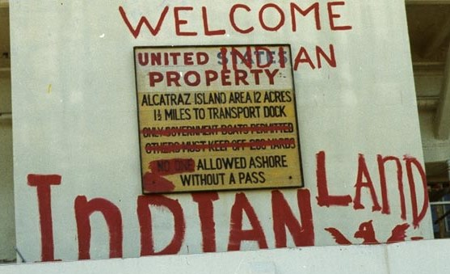
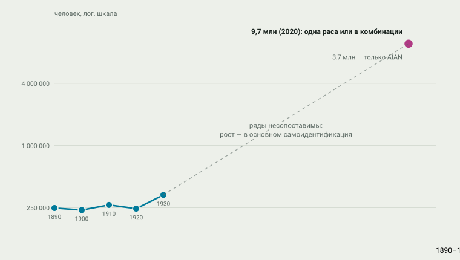

# 12. Возвращение через право

> **Статус:** черновик.

[Глава 11](11-assimilyaciya.md) кончилась тем, что политика растворения не
растворила: языки, сети, вера уцелели. Эта глава — о том, как уцелевшие
народы развернули инструменты завоевания в обратную сторону. Договор,
которым отнимали землю ([глава 9](09-pereselenie.md)), стал основанием
претензий; «опека» из решений Маршалла — аргументом суверенитета; конституции
и международные нормы — новой ареной. Опорный тезис № 8 во второй части:
возвращение шло правом, и оно же честно показывает пределы: «суверенитет» и
«самоопределение» значат разное в США, Канаде и Латинской Америке.

Короткий итог проверки. Тезис держится, а его герой — не суды и конгрессы
сами по себе, а связка «выжившие народы + старые документы»: McGirt v.
Oklahoma (2020) решил, что резервация криков не расформирована, словами
Горсуча — «раз Конгресс не сказал иного, мы держим государство на слове»
(формулировка — в передаче открытых сводок; текст решения конспекту
недоступен).[^mcgirt2020] Но у возвращения есть и цена, и неравенство:
казино разбогатили одни, суд десятилетиями идёт за другими, а чилийский
референдум 2022 г. показал, что большинство общества к плюринациональности
ещё не готово.

## США: от реорганизации к самоопределению

Вехи ложатся в одну линию (рисунок 12.2). Закон о реорганизации 1934 г.
остановил аллотмент ([глава 11](11-assimilyaciya.md)) и разрешил племенам
«организоваться для общего блага» с собственными конституциями.[^ira1934]
Через двадцать лет Конгресс снёс и это: резолюция 108 (1953) объявила
«чувство Конгресса», что названные племена «должны быть освобождены от
федеральной опеки и контроля в кратчайший возможный срок»,[^hcr108] а закон
PL-280 передал пяти штатам уголовную и гражданскую юрисдикцию на
резервациях.[^pl280] Терминацию остановил президент: в послании от 8 июля
1970 г. Никсон признал «политику принудительной терминации» ошибочной и
назвал новый курс дословно — «самоопределение без терминации».[^nixon1970]

Давление шло и снизу. В 1968 г. в Миннеаполисе возникло Движение
американских индейцев;[^aim-history] 20 ноября 1969 г. активисты «Индейцев
всех племён» заняли остров Алькатраз и держали его девятнадцать месяцев —
последних пятнадцать человек федеральные агенты сняли 11 июня 1971
года[^alcatraz-nps] (рис. 12.1). В 1973-м отряд ДАИ вместе с оглала держал
Вундед-Ни семьдесят один день — место резни 1890 г. выбрали неслучайно.[^aim-history]

<picture></picture>

**Рис. 12.1.** «Welcome to Indian Land» — надпись оккупации на водонапорной
башне Алькатраса (сделана в 1969–1971 гг.; сфотографирована позднее). Лозунг
поворачивает язык колонизации обратно к говорящему. *Фото:* Служба
национальных парков (GOGA); Wikimedia Commons, общественное достояние
(США); снимок уменьшен.[^graffiti1969]

Правовая база возвращения собрана в 1970–1990-е. Закон о самоопределении
(1975) обязал министра «по запросу любого индейского племени» заключать с
ним контракты на управление федеральными программами — знаменитые
«контракты 638».[^isdeaa1975] Закон о благополучии индейских детей (1978)
отвечал на признанную Конгрессом «тревожно высокую долю индейских семей,
разрушаемых изъятием… их детей» — по сводкам защиты детей, до закона
изымалось 25–35% индейских детей, 85% из них — за пределы индейских
семей.[^icwa1978] Закон об игорном регулировании (1988) создал племенным
правительствам легальную индустрию: валовый доход племенных казино за 2025
финансовый год — 46,2 млрд долларов.[^igra1988][^nigc2026] NAGPRA (1990)
запустил репатриацию останков и предметов; в 2024 г. новое правило прямо
обязало музеи и агентства «отдавать приоритет традиционным знаниям»
потомков и племён.[^nagpra1990][^nagpra2024]

<picture>
  <source media="(prefers-color-scheme: dark)" srcset="img/12-timeline-dark.svg">
  
</picture>

**Рис. 12.2.** Возвращение через право: вехи 1934–2024. *Данные:* из
[data/renewal.json](../data/renewal.json) со ссылками; цитаты и даты — по
первичным текстам законов и решений, где конспекту был доступ.

## Канада: титул, конституция, Нунавут

Канадская линия началась с ничьей, которая всё решила. В деле Калдера
(1973) Верховный суд разделился три-три-один, но сам факт обсуждения
признал: аборигенные права на землю существуют в праве — позже Верховный
суд назвал это началом «современной эры аборигенного земельного права»
(формулировка — из решения Tsilhqot'in, параграф 10).[^calder1973][^tsilhqotin2014]
Статья 35 Конституционного акта 1982 г. «признаёт и подтверждает
существующие аборигенные и договорные права» коренных народов Канады —
индейцев, инуитов и метисов.[^ca1982]

Дальше — суд за судом. Delgamuukw (1997): «нормы доказательственного права
должны быть адаптированы, чтобы… устные истории заняли равное
положение» с документами,[^delgamuukw1997] а аборигенный титул включает
«право исключительного пользования и владения» и право выбирать, как
использовать землю.[^delgamuukw1997] Tsilhqot'in (2014) — первое в истории
страны декларативное решение о титуле на конкретную землю.[^tsilhqotin2014]
Нунавут: соглашение 1993 г. дало инуитам около 350 000 км² земли, а с 1
апреля 1999 г. на карте появилась новая территория.[^nunavut1993]
Комиссия по установлению истины и примирению (2015) завершила канадский
счёт школам ([глава 11](11-assimilyaciya.md)) 94 «призывами к
действию».[^trc2015] По переписи 2021 г. коренных жителей Канады — 1 807 250,
пять процентов населения.[^statcan2022]

## Латинская Америка и мир: конвенция, декларация, конституции

Международное право дало рамку. Конвенция МОТ № 169 (1989) обязала
государства консультироваться с коренными народами «искренне… с целью
достижения согласия» и признала «права владения и пользования землями,
которые они традиционно занимают»;[^ilo169] ратифицировали её 24 страны —
почти все латиноамериканские (первая — Мексика, 1990; Чили — только в
2008-м).[^ilo169] Декларацию ООН о правах коренных народов (2007) Генассамблея
приняла 143 голосами при четырёх против — США, Канада, Австралия и
Новая Зеландия; все четыре позже сменили позицию.[^undrip2007]

В самой Латинской Америке столетие началось с выстрела: 1 января 1994 г.,
в день вступления НАФТА, сапатисты подняли восстание в Чьяпасе — Первая
декларация Лакандонской сельвы начинается словами «Сегодня мы говорим:
достаточно!».[^ezln1993] Конституции пошли дальше деклараций: Эквадор
(2008) объявил себя «плюринациональным» государством и дал правам природы
конституционный статус — «природа, или Пача Мама… имеет право на то, чтобы
её существование уважалось целиком»;[^ecuador2008] Боливия (2009) стала
«Плюринациональным Государством».[^bolivia2009] Чили пошло иначе: проект
конституции 2022 г. с плюринациональностью отклонили 61,9% голосов; второй
проект, без неё, отклонили в 2023-м.[^chile2022] Возвращение, как видно, не прямолинейно — оно спорно и обратимо.

> [!NOTE]
> **Оценка конспекта.** Суверенитет вернулся по-разному: в США — как
> власть племенных правительств над своей землёй (компакты, 638, McGirt);
> в Канаде — как признанный титул и договорный процесс; в Латинской
> Америке — как коллективные права в конституциях и конвенции. Общего —
> одно: везде опорой оказались старые документы (договоры, прокламации,
> королевские ордонансы), которые государства когда-то подписали, не
> рассчитывая, что их придётся исполнять.

## Демография возвращения

Переписи отмечают возвращение числом: 248 тысяч в 1890-м — 9,7 миллиона
«американских индейцев и коренных жителей Аляски» (в одиночной или
смешанной идентификации) в 2020-м.[^census2020] Но ряды несопоставимы:
рост в основном отражает готовность людей называть себя индейцами — ту
самую самоидентификацию, которую переписчики веками «не замечали»
([глава 11](11-assimilyaciya.md): предостережение Арнера,
1937).[^arner1937] График честнее читать так: не «народ размножился», а
«народ перестал скрываться».

<picture>
  <source media="(prefers-color-scheme: dark)" srcset="img/12-return-dark.svg">
  
</picture>

**Рис. 12.3.** Демографическое возвращение по переписям США. *Данные:*
1890–1930 — подсчёт Арнера (1937), полный текст; 2020 — перепись США
(9,7 млн в одиночной или комбинированной идентификации; 3,7 млн — только
AIAN);[^census2020] промежуточные десятилетия конспект не смог сверить по
первичным таблицам — разрыв показан разрывом, а не линией.

## Вывод

| Утверждение (тезис № 8 и его версии) | Что показывают источники | Итог |
|---|---|---|
| Возвращение шло правом | «638» (1975), ст. 35 (1982), McGirt (2020), NAGPRA-2024; Нунавут (1993–1999) | держится |
| Опора — старые договоры и акты | McGirt: договор 1866/1832 гг. («держим государство на слове» — в передаче); Блэк-Хиллс: компенсация не принята | держится |
| Право одно на всех | США: правительства племён; Канада: титул и договоры; Лат. Америка: коллективные права | оценка: пути разные |
| Экономика вернулась | казино 46,2 млрд долл. (2025 фин. г.) — но богатство распределено неравномерно | частично; детально — за рамками главы |
| Демография восстановилась | 248 тыс. (1890) → 9,7 млн (2020) при смене метода счёта | восстановилась с оговоркой о несопоставимости рядов |
| Конституционное признание необратимо | Чили: 2022 и 2023 — оба проекта отклонены | нет: обратимо голосованием |

Что может измениться. Цитаты McGirt — в передаче открытых сводок; текст
решения нужно сверить. Числа терминированных племён («более 100») — по
сводкам, первичные отчёты конгрессовых комиссий недоступны. Межпереписные
десятилетия 1940–2010-х для графика взяты не были — добрать по таблицам
Census, чтобы линия стала непрерывной. Отношения «казино — бедность»
заслуживают отдельной главы, которой в конспекте нет.

Дальше — [глава 13](13-skvoznye-mehanizmy.md): шесть механизмов, которые
работали от Беринии до McGirt, и итоговая проверка всех восьми тезисов.

## Источники

[^ira1934]: Indian Reorganization Act 1934, §16 (полный текст, govinfo).
[^hcr108]: H. Con. Res. 108 (1953) (полный текст, govinfo).
[^pl280]: Public Law 280 (1953) (полный текст, govinfo).
[^nixon1970]: Nixon 1970, разд. «Self-Determination Without Termination» (полный текст, American Presidency Project).
[^aim-history]: Wittstock & Salinas, A Brief History of AIM (полный текст, aimovement.org); Вундед-Ни-1973 (71 день) — в передаче открытых сводок.
[^alcatraz-nps]: NPS, We Hold the Rock (полный текст).
[^graffiti1969]: Граффити Алькатраса (изображение; NPS GOGA; Wikimedia Commons, общественное достояние США).
[^isdeaa1975]: ISDEAA 1975, §102(a) (полный текст, govinfo).
[^icwa1978]: ICWA 1978, §2(4), §3 (полный текст, govinfo); доли изъятий 25–35% и 85% — по странице NICWA «About ICWA» (в передаче).
[^igra1988]: IGRA 1988 (полный текст, govinfo).
[^nigc2026]: NIGC, FY 2025 GGR Report (полный текст PDF).
[^nagpra1990]: NAGPRA 1990 (полный текст, govinfo).
[^nagpra2024]: Final Rule 88 FR 86452 (полный текст аннотации, Federal Register).
[^mcgirt2020]: McGirt v. Oklahoma (2020); текст конспекту недоступен; формулировка «we hold the government to its word» — в передаче открытых сводок с указанием на текст решения.
[^calder1973]: Calder (1973) — состав по сводкам; характеристика — Tsilhqot'in 2014, para 10 (полный текст).
[^ca1982]: Constitution Act 1982, s. 35(1)–(2) (полный текст, Department of Justice Canada).
[^delgamuukw1997]: Delgamuukw (1997), para 87, 111 (полный текст, SCC).
[^nunavut1993]: Nunavut Land Claims Agreement Act; Nunavut Act (полные тексты); ключевые положения — по странице Nunavut Tunngavik Inc. (350 000 км²).
[^tsilhqotin2014]: Tsilhqot'in (2014), para 10, 153 (полный текст, SCC).
[^trc2015]: TRC 2015, Executive Summary; Calls to Action (полные тексты, NCTR).
[^statcan2022]: Statistics Canada, The Daily, 21.09.2022 (полный текст).
[^ilo169]: ILO C169: текст (ст. 6, 14) и таблица ратификаций — NORMLEX (полные тексты).
[^undrip2007]: UN GA/10612, 13.09.2007 (полный текст пресс-релиза: 143 за, 4 против); смена позиций четырьмя странами — по открытым сводкам.
[^ezln1993]: Primera Declaración de la Selva Lacandona («HOY DECIMOS ¡BASTA!») (полный текст, Wikisource/Enlace Zapatista).
[^ecuador2008]: Constitución del Ecuador 2008, ст. 1 и 71 (полный текст, Wikisource).
[^bolivia2009]: Constitución de Bolivia 2009, ст. 1 (полный текст, Constitute Project).
[^chile2022]: Плебисцит 2022 г. (результаты SERVEL — в передаче открытых сводок).
[^census2020]: U.S. Census Bureau, Facts for Features 2023 (9,7 млн; полный текст страницы).
[^arner1937]: Arner 1937 (полный текст скана).
