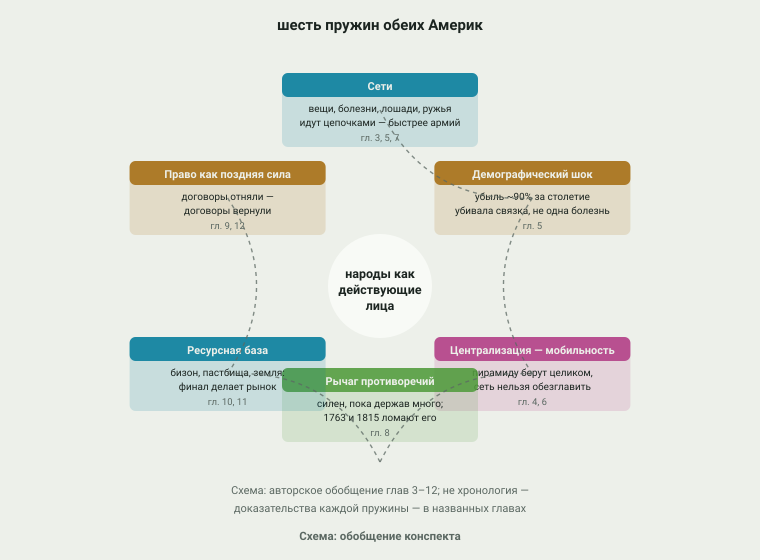

# 13. Сквозные механизмы

> **Статус:** черновик.

Двенадцать глав шли хронологически — от Беринии до McGirt v. Oklahoma. Эта
глава идёт не по времени, а по механизму: собирает повторяющиеся пружины,
которые срабатывали в разных веках и на разных концах обеих Америк, и
подводит честный итог: что из восьми опорных тезисов конспекта подтвердилось,
что уточнилось, что осталось оценкой или гипотезой. Это глава-вывод; её
доказательства — в предыдущих главах, и она честно отправляет к ним.

## Шесть пружин

**1. Сети.** Вещи, болезни, лошади и ружья шли по одним и тем же цепочкам —
и всегда быстрее государств и армий. Обсидиан и медь хоупвелла ([гл.
3](03-slozhnye-obshchestva.md)), оспа, обогнавшая Писарро ([гл.
5](05-epidemii.md)), лошадь, пришедшая на равнины за полтора века до
солдат ([гл. 7](07-loshad-i-ruzhyo.md)), — один и тот же механизм:
контакт, который уже есть, но которого «ещё не было». Обратная сторона та
же: где цепочек не было, волны глохли — провинция Хемес ждала колонистов,
а не эпидемий ([гл. 4](04-perehodnaya-zona.md)).

**2. Демографический шок.** Убыль около 90% за столетие ([гл.
5](05-epidemii.md)) — не фон истории, а её участник: она решила падение
Теночтитлана, расчистила Атлантическое побережье для колоний и оставила
след даже в льдах Гренландии. Но «болезнь убила слабых» — неверная формула:
убивала связка болезни с войной, рабством и голодом, и там, где связки не
было, смертность была ниже.

**3. Централизация и мобильность.** Пирамиду можно было захватить целиком —
и Теночтитлан с Куско пали за два года ([гл. 6](06-udar-po-centru.md));
сеть нельзя было обезглавить — и «чичимеки», майя, мапуче растянули
завоевание на века. Но «дольше» не значит «спастись»: mobile народы
погибли от рынков и губили сами свою базу — перевыпас равнин к 1840-м
([гл. 7](07-loshad-i-ruzhyo.md)) — а оседлые пуэбло без центра смогли
поднять успешное восстание ([гл. 4](04-perehodnaya-zona.md)). Механизм
работает в паре: форма общества задаёт срок, ресурсы — исход.

**4. Рычаг противоречий.** Пока держав было несколько, народы были нужны
всем — и Монреаль 1701 г., и парламенты мапуче, и команчерия держались на
этом ([гл. 8](08-epoha-balansa.md)). 1763 и 1815 гг. убили противовесы на
севере — и через поколение началась «Тропа слёз» ([гл.
9](09-pereselenie.md)). На юге рычаг жил дольше — до 1840-х у команчей и до
1880-х у мапуче — по одной причине: там противоречия держав сохранялись
дольше.

**5. Ресурсная база.** Всё держалось на кормовой и правовой базе: кукуруза
Кахокии, бизон равнин, пастбища пампы, сама земля. Финал 1875–1885 гг.
([гл. 10](10-sinhronnyj-final.md)) — это прежде всего экономическая
операция: шкура, шерсть и мясо опередили пули. Ассимиляция ([гл.
11](11-assimilyaciya.md)) продолжила ту же логику миром: земля, разделённая
на участки, переставала быть общиной.

**6. Право как поздняя форма силы.** Договоры, которыми отнимали, стали
опорой возвращения: «раз Конгресс не сказал иного, мы держим государство на
слове» — McGirt ([гл. 12](12-vozvrashchenie.md)). Это не ирония истории, а
её механика: документы переживают намерения тех, кто их писал.

<picture>
  <source media="(prefers-color-scheme: dark)" srcset="img/13-mechanisms-dark.svg">
  
</picture>

**Рис. 13.1.** Шесть сквозных механизмов. *Схема:* авторское обобщение глав
3–12; не хронология и не зависимость — связи показаны направлением, а не
весом. Доказательства каждой — в названных главах.

## Итог по восьми тезисам

| № | Тезис | Что показало исследование | Итог глав |
|---|---|---|---|
| 1 | Заселение шло несколькими волнами | [гл. 1](01-zaselenie.md) | подтверждён с уточнением дат |
| 2 | Развитие самостоятельное; связи — через посредников | [гл. 2](02-zemledelie.md), [гл. 3](03-slozhnye-obshchestva.md), [гл. 4](04-perehodnaya-zona.md) | подтверждён; «эстафета» — лишь один из способов, были и переселения, и разведение, и дань |
| 3 | Эпидемии — катастрофа, предшествовавшая завоеванию | [гл. 5](05-epidemii.md) | подтверждён для хронологии; «девственная почва» недостаточна — смертность делала окружение |
| 4 | «Классический индеец» равнин — послеконтактное явление | [гл. 7](07-loshad-i-ruzhyo.md) | подтверждён и уточнен: лошадь усвоена уже в XVI в., восстание пуэбло — ускорение |
| 5 | Сила народов держалась на противоречиях держав; 1763 и 1815 | [гл. 8](08-epoha-balansa.md) | подтверждён; на юге те же механизмы с другими датами |
| 6 | Удар по центру — быстрые победы; мобильные держались дольше | [гл. 4](04-perehodnaya-zona.md), [гл. 6](06-udar-po-centru.md) | подтверждён для сроков; «дольше» ≠ «спастись»; победы делали союзники |
| 7 | Синхронный финал 1875–1885 — общие причины | [гл. 10](10-sinhronnyj-final.md) | синхронность — факт; причинность — оценка с хорошей хронологией |
| 8 | Ассимиляция — затем возвращение через право | [гл. 11](11-assimilyaciya.md), [гл. 12](12-vozvrashchenie.md) | подтверждён; асимиляция провалилась как растворение, удалась как травма; возвращение шло разными путями |

## Где аналогии между севером, Мезоамерикой и югом работают

Работают там, где речь о механике: сеть, рычаг, база, право — эти пружины
действительно одни и те же от Гудзонова залива до Патагонии. Ломаются там,
где речь о шкале: «государство», «народ», «союз», «война» в трёх зонах
несоразмерны — держава инков и лига хауденосауни не лежат на одной оси
«централизации», а парламент мапуче и договор США несопоставимы по
юридической судьбе. Конспект поэтому избегал общей шкалы и везде начинал с
устройства конкретного общества.

## Что осталось гипотезами конспекта

Часть выводов — авторские обобщения, а не установленные факты: успех
восстания пуэбло как заслуга союзников-апачей ([гл. 4](04-perehodnaya-zona.md));
«богатое угодье» как общая пружина сложных обществ ([гл.
3](03-slozhnye-obshchestva.md)); причинная связка общих причин финала
1875–1885 ([гл. 10](10-sinhronnyj-final.md)); прочитывание волн болезней как
функции цепочек контакта ([гл. 5](05-epidemii.md)). Каждая помечена в своих
главах; все — проверяемы и должны рушиться от источников, а не мнений.

## Что дальше

Конспект — рабочая вещь: главы после сверки источников получают статус
«принято» и публикуются на сайте с полной прозрачностью сверки. Сильнейшие
неопределённости, которые стоит атаковать следующими: численность 1492 г.
(разброс оценок — в разы); возбудитель кокольицтли; средние десятилетия
демографического ряда США; первичные тексты по чилийско-аргентинским
кампаниям. Тема, которой в конспекте нет и которая напрашивается: африканцы
и афроамериканцы в истории обеих Америк — соседи, союзники и рабы коренных
народов; они появляются в главах 5, 6 и 9, но заслуживают собственной.

История, которую прошёл читатель, — не история «исчезающей расы». Она про
то, как общества с другими устройствами встретили мир, сделанный чужими
правилами, — держались в нём дольше, чем кажется по школьным учебникам,
сломали несколько империй сами и вернули себе место в праве, когда сила
кончилась. Продолжение следует — в архивах, лабораториях и судах.

## Источники

[^hamalainen2022]: Hämäläinen 2022 (только описание; контур «континента коренных народов» — по аннотации издательства).
